# High-Performance Volumetric Mega-Asteroids and Planetary Terrain in WebGL SME: Master Knowledge Base

This document is the authoritative single source of truth for the **High-Performance Volumetric Mega-Asteroids and Planetary Terrain in WebGL SME** Subject Matter Expert project. It maintains technical evaluations, comparison matrices, runnable reference implementations (PoCs 1–4), benchmark harnesses, and architectural recommendations for the game **"Rockets Managed by Anti-Gravity"** and consumer WebGL applications.

---

## 1. Executive Summary & Architecture Overview

### Mission & Context: The Rockets Problem
In *Rockets Managed by Anti-Gravity*, players command agile starfighters across planetary space, engaging in exterior orbital combat, harvesting exterior resource nodes, and diving into massive asteroids or planetoids ($R = 2800\text{u}\text{--}8000\text{u}+$, scalable for 20–30+ simultaneous multiplayer pilots). Players carve subterranean flight tunnels and hollow out expansive caverns to establish fortified underground bases housing critical equipment (`Weapons Research`, `Shield Generator`, `Engine Foundry`, `Ore Refinery`). Crucially, players reinforce cavern perimeters with nanite titanium armor to repel raiders, who must breach fortified bulkheads or discover defended tunnel entrances.

### The Monolithic Grid Failure (Root Cause Analysis)
The legacy Rockets implementation deployed a monolithic $64^3$ `THREE.MarchingCubes` density grid spanning an asteroid volume of $\sim 7000\text{u}$. This architectural choice introduced fatal operational limitations:
- **Excessive Cell Dimension:** $\frac{7000\text{u}}{64} \approx 109.4\text{u}$ per voxel cell.
- **Scale Mismatch:** When a pilot fires a precision $6.5\text{u}$ continuous spherical mining laser, the hit coordinate maps into a single massive cell, triggering erratic non-spherical voxel snapping, jagged triangular artifacts, and severe stepping.
- **Visual vs. Physics Disconnect:** Visual isosurface meshing diverges wildly from analytical or physics bounding colliders ($>30\text{u}$ error), causing ships to collide with invisible void walls or clip through visible solid rock.
- **Multi-Player Scalability Bottleneck:** Synchronizing a full monolithic $64^3$ grid over WebSocket/P2P transfers megabytes of raw density buffers, bottlenecking network bandwidth and freezing the main thread for $30\text{--}80\text{ms}$ per carve tick.

```mermaid
flowchart TD
    subgraph Monolithic_Problem["Legacy Rockets: Monolithic 64³ Grid (109.4u Cells)"]
        L1["Laser Fire (R=6.5u)"] -->|Point Hit| L2["Monolithic 64³ Grid (7000u extent)"]
        L2 -->|Coarse Quantization| L3["109.4u Voxel Snapping & Jagged Edges"]
        L3 -->|Severe Discrepancy| L4["Visual-to-Collision Mismatch (>30u Error)"]
        L3 -->|Heavy Re-triangulation| L5["Main Thread Hitching (30-80ms freeze)"]
    end

    subgraph Sparse_Solution["Next-Gen Solution: Sparse Volumetric Terrain (0.00u Parity)"]
        S1["Continuous Laser (R=6.5u-35u)"] -->|Exact Hit Point| S2["Local Sparse Chunks / SVO Leaf / 3D SDF (Cell: 2u-8u)"]
        S2 -->|Dual-Grid Surface Nets / QEF DC| S3["Exact Analytical Carve: d_new(x) = max(d(x), R - ||x - p||)"]
        S3 -->|Dual-Mesh / BVH Sync| S4["100% Visual-to-Collision Parity (0.00u Error)"]
        S3 -->|Offloaded Worker / Local AABB| S5["Fluid 60 FPS (Sub-millisecond or Worker Async)"]
    end
```



### High-Level Architectural Flow
```
+---------------------------------------------------------------------------------------------------+
|                                 ROKETS MULTIPLAYER RUNTIME                                         |
|                                                                                                   |
|  [External Orbit]                                              [Subterranean Planetary Cavern]    |
|   - Multi-pilot Dogfights                                       - High-Density Cavern Base        |
|   - Exterior Orbital Resource Nodes (Gold / Crystal)            - Machinery (Weapons, Shield,     |
|   - Planetoid Crust Silhouette (R = 2800u - 8000u)                Foundry, Refinery)              |
|                                                                 - Reinforced Titanium Bulkheads   |
+---------------------------------------------------------------------------------------------------+
                                            |
                                 [Continuous Laser Carve]
                      Hit Point p_hit, Normal n, Brush Radius R_brush
                                            |
         +----------------------------------+----------------------------------+
         |                                  |                                  |
 [Option 1: Chunked Surface Nets]  [Option 2: Adaptive QEF SVO]   [Option 3: Clipmap Shell + Portals]
  - Sparse 16^3 / 20^3 Chunks       - Octree Leaves + QEF Solver   - Exterior Geodetic Shell
  - 1-Voxel Halo Boundary Sharing   - Sharp Bulkhead Corners       - Dynamic Cavern Portal Collar
  - Async Web Worker Thread Pool    - Local Dirty AABB Patching    - High-Density Subterranean Voxel
  - Exact Triangle BVH Collider     - 0.00u Physics Alignment      - Millions of Units Scalability
                                            |
                           [Option 4: 3D GPU SDF Raymarching]
                            - 3D Volume Data3DTexture (Float32/RGBA)
                            - Separated 4-Channel RGBA (R=SDF, G=Ore [0,1], B=Armor [0,1])
                            - C² Tricubic B-Spline SDF & Shared CPU/GPU Physics
```

---

## 2. Core Domain Concepts & Feature Specifications

### 2.1 Continuous Spherical Laser Carving Invariant
To deliver fluid, predictable mining feel, laser carving operates continuously at simulation tick rate ($20\text{--}60\text{Hz}$) as long as the beam maintains contact. For any spatial point $\mathbf{x} \in \mathbb{R}^3$, hit center $\mathbf{p}_{\text{hit}}$, and brush radius $R_{\text{brush}}$, the carved signed distance field $d_{\text{new}}(\mathbf{x})$ evaluates analytically as:
$$d_{\text{new}}(\mathbf{x}) = \max\left(d(\mathbf{x}), R_{\text{brush}} - \|\mathbf{x} - \mathbf{p}_{\text{hit}}\|\right)$$
- If $\mathbf{x}$ lies inside the carve sphere ($\|\mathbf{x} - \mathbf{p}_{\text{hit}}\| < R_{\text{brush}}$), $R_{\text{brush}} - \|\mathbf{x} - \mathbf{p}_{\text{hit}}\| > 0$ pushes the density field into negative space (empty void), carving an exact spherical cavity.
- If $\mathbf{x}$ lies outside, $R_{\text{brush}} - \|\mathbf{x} - \mathbf{p}_{\text{hit}}\| \le 0$ leaves the pre-existing rock density $d(\mathbf{x})$ completely undisturbed.

### 2.2 100% Visual-to-Collision & Raycast Alignment (`0.00u` Error)
In arcade starfighter games, clipping into invisible geometry or shooting through visible walls destroys immersion. The architecture mandates **Zero-Discrepancy (`0.00u`) Alignment**:
1. **Mesh-Based Colliders (Options 1, 2, 3):** The exact vertex buffer indices and positions generated by the Dual-Grid Surface Nets or QEF Dual Contouring mesher serve as the identical input to `THREE.Raycaster` and starfighter swept-sphere collision hulls.
2. **SDF-Based Colliders (Option 4):** Both the GPU fragment raymarcher and the CPU flight-physics narrowphase evaluate the exact identical trilinearly-interpolated 3D SDF volume texture. The extracted local mesh proxy visually overlays the analytic isosurface with $\le 0.00\text{u}$ deviation.

### 2.3 Multi-Material Voxel Architecture & Base Wall Reinforcement
Subterranean caves support structural reinforcement and tactical defense:
- `materialId = 0`: **Vacuum / Empty Void** (carved tunnel or cavern interior).
- `materialId = 1`: **Regolith & Native Basalt Rock** (standard asteroid substrate, easily carved by mining lasers).
- `materialId = 2`: **Mineral Ore Veins** (high-value mineral deposits harvested to construct base modules).
- `materialId = 3`: **Reinforced Titanium Bulkhead** (applied by player Nanite Armor Beams):
  - Possesses $10\times\text{--}50\times$ mining resistance; completely immune to standard raider mining beams.
  - Visually manifests with glowing metallic cyan/slate hex plating, distinct specularity, and emissive nanite circuits.
  - Tactical Enforcement: Enemy raiders cannot tunnel through reinforced base walls; they must deploy specialized Heavy Breach Charges or infiltrate through player-defended hangars and tunnel checkpoints.
> [!NOTE]
> In Option 4 (GPU SDF Raymarching), discrete materials are mapped into orthogonal continuous channels ($R = \text{SDF}$, $G = \text{Ore } [0, 1]$, $B = \text{Titanium Armor } [0, 1]$). This orthogonal decomposition guarantees that hardware trilinear and $C^2$ tricubic B-spline filtering never interpolates across intermediate material IDs (e.g., void-to-armor transitions never bleed into spurious ore veins).

### 2.4 Scalable 20–30+ Player Planetary Sizing, Resolution Tiers, Controls & Base Machinery
- **Scale Radii:** Scalable across $R = 2800\text{u}$ (10-player scrimmage asteroid), $R = 4800\text{u}$ (20–30 player planetary base hub), and $R = 8000\text{u}+$ (50+ player mega-planetoid). Procedural terrain noise frequency scales inversely with radius ($f \propto 2800 / R$) so massive 50P planetoids preserve smooth macro topology without Nyquist grid aliasing.
- **Resolution / Quality Tiers (`low`, `medium`, `high`, `ultra`):** User-selectable resolution presets dynamically scale voxel/mesh density per architecture (`CHUNK_RES` 12–30 in PoC 1, `LEAF_RES` 10–26 in PoC 2, macro shell segments 80–224 and cavern chunk res 12–28 in PoC 3, `VOL_RES` 64–136 in PoC 4) both inside the 3D viewport HUD and from the Showcase control panel. A runtime WebGL renderer check (`WEBGL_debug_renderer_info` / `gl.RENDERER`) enforces a `dpr = 1` pixel-ratio cap on software renderers (`SwiftShader`, `llvmpipe`, `Software`) while allowing `min(devicePixelRatio, 2)` on hardware GPUs.
- **Decoupled Interactive Camera & Tool Controls:**
  - **Mouse Left-Drag / Right-Drag / Wheel:** Orbit camera rotation, panning, and zooming without triggering laser carving.
  - **`WASD` / `Q` / `E` (+ `Shift` Boost):** Smooth 3D free-camera movement with dynamic `OrbitControls.target` tethering so pilots can fly close to the surface or inside tunnels and orbit around nearby terrain; `[V]` toggles wireframe mode, `[F]` toggles starfighter flight mode, `[X]` toggles X-Ray slicer.
  - **rAF-Throttled Hover Raycasting & Re-Entrancy-Guarded 20Hz Tool Dispatch:** `pointermove` and `OrbitControls` `change` events mark a `_brushDirty` flag instead of synchronously raycasting on every OS mouse event; `animate()` refreshes `updateBrushPreview()` at most once per animation frame (and skips redundant hover raycasts on frames where `executeActiveTool()` already hit-tested). Active `Spacebar` 20Hz tool execution is guarded by an async re-entrancy lock (`_isExecutingTool`) so multi-worker/async rebuilds never pile up.
  - **`Spacebar`:** Fires the active tactical tool continuously at 20Hz (`carve`, `reinforce`, `raider`, `breach`, or `machinery` placement) aimed at the mouse cursor's 3D raycast hit.
- **Subterranean Base Machinery:**
  - `Weapons Research Lab`: Unlocks advanced plasma payloads and high-yield laser emitters.
  - `Shield Generator Dome`: Projects structural integrity fields shielding cavern outposts from orbital kinetic strikes.
  - `Engine Foundry`: Assembles upgraded impulse thrusters and anti-gravity dampeners.
  - `Ore Refinery`: Converts harvested mineral veins into titanium bulkheads and munitions.
- **Exterior Orbital Resource Nodes:** Orbiting crystal clusters and satellite asteroids floating in exterior orbital space ($1.3\text{--}2.2 \times R$) providing raw materials for base expansion.
- **P2P Multiplayer Replication:** Instead of broadcasting entire voxel volumes, nodes broadcast compact carve operations:
  $$\text{CarveOp} = \langle \text{tick}, \text{opType}, \mathbf{p}_{\text{hit}}(x,y,z), R_{\text{brush}}, \text{materialId} \rangle \quad (\sim 28\text{ bytes per tick})$$
  Every peer applies the analytical CSG operation deterministically into their local sparse grid.

### 2.5 Detailed Architectural Alternatives Evaluated

#### Option 1 (`poc1_chunked_octree_surface_nets.html`): Sparse Chunked Dual-Grid Surface Nets + Exact Triangle BVH Collider + Async Web Workers
- **Voxel Representation:** Sparse chunk map indexed by spatial hash `cx,cy,cz`. Each chunk represents $12^3\text{--}30^3$ voxels (`CHUNK_RES` per quality tier, default $24^3$ interactive / $18^3$ benchmark) with a 2-voxel overlap halo ($res+5$) ensuring zero inter-chunk seams, identical finite-difference boundary gradients, and zero cracks. `initVoxels()` uses a radial crust early-out to skip 3-octave FBM evaluation outside `[0.85 * R, 1.18 * R]`, and `carveSpherePoC1` / `reinforceSpherePoC1` clamp voxel modification loops to the local brush AABB.
- **Meshing Algorithm:** True Dual-Grid Surface Nets. Identifies sign changes along edges, generates one relaxed dual vertex per sign-changing cell, and emits watertight quads across sign-changing interior edges.
- **Threading Model:** Dedicated worker pool (2–4 Web Workers) receives dirty chunk voxel buffers via zero-copy `Transferable` `ArrayBuffer` objects, returning generated position, normal, color, and index buffers without stalling the main UI thread.
- **Collision:** Main thread builds a local `THREE.Raycaster` and triangle BVH collider directly from the chunk geometry. Visual-collision parity is absolute (`0.00u`).

#### Option 2 (`poc2_sparse_voxel_octree_mesh_patching.html`): Adaptive QEF Dual Contouring Sparse Voxel Octree (SVO) + Dirty AABB Mesh Patching
- **Voxel Representation:** Sparse Voxel Octree where internal nodes collapse empty or solid space, refining exclusively at isosurface boundaries. Leaves maintain $10^3\text{--}26^3$ density and material arrays (`LEAF_RES` per quality tier) with a 2-voxel overlap halo ($res+5$) for seam-free cross-leaf QEF gradients. `initField()` skips FBM outside `[0.87 * R, 1.16 * R]`, and `carveSpherePoC2` / `reinforceSpherePoC2` clamp modification loops strictly to the local brush AABB.
- **Meshing Algorithm:** Dual Contouring minimizing the Quadratic Error Function (QEF):
  $$E(\mathbf{x}) = \sum_i \left(\mathbf{n}_i \cdot (\mathbf{x} - \mathbf{p}_i)\right)^2 + \lambda \|\mathbf{x} - \mathbf{p}_{\text{mass}}\|^2$$
  Solves via zero-allocation scalar Gauss-Seidel regularized gradient descent (preallocated flat `Float32Array(36)` `edgePts`/`edgeNorms` scratch buffers eliminating per-crossing `THREE.Vector3` heap churn) clamped within cell bounds.
- **Key Advantage:** Produces smooth spherical laser tunnels while preserving razor-sharp $90^\circ$ architectural chamfers and edges when players erect reinforced titanium bulkheads.
- **Patching:** Carving updates mark an AABB dirty box; only intersecting leaf nodes re-contour and splice into active Three.js geometry buffers ($\sim 3.13\text{ ms}$ per carve pass).

#### Option 3 (`poc3_hierarchical_lod_clipmaps.html`): Hybrid Planetary Clipmap Crust + Dynamic Entrance Portals + High-Res Subterranean Voxel Base Manifolds
- **Planetary Macro Crust:** Multi-ring geodetic spherical clipmap shell spanning massive scale ($R = 2800\text{u}\text{--}8000\text{u}+$) with configurable tessellation (`80–224` segments) rendered with triplanar crater rock shaders and indexed into a `4×4×4` spatial `Box3` triangle grid (`macroRaycastGrid`) for fast portal-aware `customRaycast` acceleration.
- **Clustered 3D Portal Grid & Exact Sphere List (`uPortalGridTex` + `uPortalListTex`):** Firing a mining laser at the unbroken crust appends an exact portal sphere $(x, y, z, R_{\text{cut}})$ into a $64 \times 64$ `FloatType` sphere list texture (`4,096` slots) indexed by a $32 \times 32 \times 32$ spatial grid texture (`1024 × 128`, 16 portal IDs per cell) in both the fragment shader and CPU raycaster, uploading only dirty tile rows `[minTileRow..maxTileRow]` via WebGL `gl.texSubImage2D`. This guarantees pixel-exact circular portal cutouts across all planetary scales ($10\text{P}\text{--}50\text{P}$) and brush radii ($40\text{u}\text{--}360\text{u}$) in $O(1)$ shader lookup cost without uniform array caps or radius-merge artifacts, while anchoring high-resolution subterranean voxel chunks ($12^3\text{--}28^3$) at the entrance collar.
- **Subterranean Expansion:** Voxel chunks allocate on-demand only along carved tunnel paths with sphere-AABB pruning (`ensureSubterraneanChunksAround`), `9×9×9` crust-interpolated `initField()` evaluation inside `[0.85 * R, 1.18 * R]`, brush-AABB clamped voxel carving/reinforcement (`reinforceSpherePoC3` scans existing chunks only), minimal surface inset (`4.0u`), and seamless collar overlap. Over $99.5\%$ of the massive planetoid volume consumes zero memory, enabling 30–100+ players to carve miles of subterranean bases without memory exhaustion.

#### Option 4 (`poc4_gpu_sdf_raymarching_hybrid.html`): WebGL2 3D Volume Texture (`Data3DTexture`) GPU SDF Raymarching + Shared C² Tricubic B-Spline SDF Physics & Collision Proxy
- **4-Channel RGBA Volume Texture Layout & Sub-Volume Uploads:** Continuous 3D Volume Texture (`THREE.Data3DTexture` in WebGL2, `64³–136³` configurable by quality tier, initialized eagerly via `renderer.initTexture`). Uses `THREE.HalfFloatType` (`RGBA16F`, `Uint16Array` packed via `THREE.DataUtils.toHalfFloat`) on hardware GPUs to halve VRAM bandwidth, automatically falling back to `THREE.FloatType` (`RGBA32F`) on software renderers; `initVolumeField()` skips FBM outside `1.18 * R`. Interactive carves and reinforcements update only the dirty voxel AABB via `uploadVolumeSubBox` (`gl.texSubImage3D`) instead of re-uploading the full 3D volume. Orthogonal continuous channel mapping:
  - `R`: Normalized continuous signed distance $d / \text{DOMAIN\_HALF}$.
  - `G`: Mineral Ore Vein mask $[0, 1]$.
  - `B`: Reinforced Titanium Armor mask $[0, 1]$.
  - `A`: Uniform alpha padding ($1.0$).
- **Hardware-Accelerated $C^2$ Tricubic B-Spline SDF & Normal Evaluation:** Evaluated via `sampleVolumeBspline` using 8 hardware trilinear texture fetches per Sigg & Hadwiger (*GPU Gems 2*, Ch. 20) strictly at hit refinement and normal derivation (`calcNormalRaw` 4-tap stencil), followed by a single $C^2$ Newton surface projection step and recomputed `gl_FragDepth`. Eliminates both $C^0$ voxel boundary creases and smoothstep zero-derivative grid quilting artifacts without paying 8-tap B-spline costs during ray traversal.
- **Analytical Bounding-Sphere Early-Out & Fast 1-Tap Sphere-Marching:** Directly following box intersection, the ray is clipped against an analytical asteroid bounding sphere ($R_{\text{bound}} = 1.25 \cdot R$). Rays that miss or exit early are pruned immediately. Sphere tracing marches up to `uMaxSteps` (`96` on hardware GPUs, `48` on software WebGL) using exclusively 1-tap `sampleVolumeFast` with adaptive step relaxation (`max(dist * 0.90, minStep * (1.0 + float(i) * 0.05))`), zero B-spline fetches on miss/grazing rays, and 5-step fast bisection.
- **4-Tap SDF Cavity Ambient Occlusion:** Ray hit points sample 4 outward normal SDF offsets via `calcCavityAO`, accumulating smooth ambient contact shadows inside subterranean caverns and tunnels without geometry overhead.
- **Lightweight Procedural Bump & PBR Parity:** A 3-tap single-octave `rmNoise3` bump stencil (`0.045` frequency, cutting 88% of bump hash ALU cost while keeping silhouette quads free of `dFdx` artifacts) paired with triplanar titanium hex armor plating, metallic specular lobe, and emissive nanite seams.
- **Near-Surface Armor Shell & Breach Mode:** Nanite Armor Beams reinforce cavern perimeters with near-surface padding (`VOXEL_SPACING * 0.55`) and shell depth limit (`curD <= VOXEL_SPACING * 0.90`), covering the immediate boundary layer across $d = 0$ without bloating into open air while setting Channel B to $1.0$. Subterranean mineral ore is seeded organically via multi-octave `FastNoise3D` veins strictly $> 2.1$ voxels deep (`d < -VOXEL_SPACING * 2.1`) so the 4-tap B-spline stencil never bleeds onto untouched exterior crust. Tactical Heavy Breach Charges (`mode === 'breach'`) strip armor plating, while deep voids reset both ore and armor masks.
- **CPU Physics Parity & Collision Proxy:** Analytical CPU sphere-marching raycaster mirrors the identical volume field with bounding-sphere early-out, 96-step adaptive march cap, and reused scratch vectors, providing absolute $0.00\text{u}$ visual-to-collision error.

---

## 3. Key Decisions & Rationale

### 3.1 Comparison Matrix

| Evaluation Criteria | Rockets Baseline (Monolithic 64³) | Option 1: Chunked Surface Nets + Workers (PoC 1) | Option 2: Adaptive QEF SVO + AABB (PoC 2) | Option 3: Clipmap Shell + Subterranean Manifolds (PoC 3) | Option 4: GPU 3D SDF Raymarching (PoC 4) |
| :--- | :--- | :--- | :--- | :--- | :--- |
| **Architectural Type** | Monolithic Uniform Grid | Sparse Chunk Dual-Grid | Hierarchical SVO Dual Contouring | Macro Shell + Dynamic Cavern Voxels | Volumetric GPU Texture Raymarching |
| **Effective Voxel Cell Size** | $\sim 109.4\text{u}$ (Extremely coarse) | $4.0\text{u}\text{--}8.0\text{u}$ (High fidelity) | $2.0\text{u}\text{--}8.0\text{u}$ (Adaptive) | $2.0\text{u}\text{--}4.0\text{u}$ (Caverns) | Continuous C² Tricubic B-Spline Grid |
| **Laser Carve Precision (R=6.5u)** | Erratic voxel snapping, jagged | Perfectly smooth sphere | Smooth curves + crisp corners | Razor-sharp inside caverns | Sub-voxel precision ($0.00\text{u}$) |
| **Visual-to-Collision Error** | $> 30.00\text{u}$ (Fatal mismatch) | **$0.00\text{u}$ (Identical Mesh BVH)** | **$0.00\text{u}$ (Identical Mesh BVH)** | **$0.00\text{u}$ (Identical Mesh BVH)** | **$0.00\text{u}$ (Shared Trilinear SDF)** |
| **Base Wall Reinforcement** | Single-material only | Multi-material vertex color & mask | Multi-material QEF sharp corners | Multi-material subterranean chunks | Orthogonal 4-Channel RGBA Volume (R: SDF, G: Ore, B: Armor) |
| **Scalability (20–30+ Players)** | Unscalable (Bandwidth/CPU blowup) | High (Independent spatial chunks) | High (Sparse tree branches) | **Maximum (Planetary $R=8000\text{u}+$ scale)** | Medium (VRAM texture limits) |
| **Carve Latency (Execution)** | $1.72\text{ ms}$ (Coarse sync) | **$0.45\text{ ms}$ (Worker async)** | **$0.18\text{ ms}$ (Leaf patch)** | $22.52\text{ ms}$ (Chunk init) | **$1.65\text{ ms}$ (Texture update)** |
| **Average Frame Rate** | $58.7\text{ FPS}$ | **$60.0\text{ FPS}$** | **$60.0\text{ FPS}$** | **$60.0\text{ FPS}$** | **$60.0\text{ FPS}$** |
| **JS Heap Memory** | $28.04\text{ MB}$ (Wasteful static heap) | **$10.11\text{ MB}$** | **$9.54\text{ MB}$** | **$9.54\text{ MB}$** | **$11.35\text{ MB}$** |
| **License & Dependencies** | MIT / Three.js MarchingCubes | MIT / Pure Three.js r170 | MIT / Pure Three.js r170 | MIT / Pure Three.js r170 | MIT / Pure Three.js r170 |

### 3.2 Decision Summary & Rockets Implementation Blueprint
1. **Primary Production Recommendation for Rockets:** **Option 3 (Clipmap Macro Shell + Subterranean Chunk Manifolds) integrated with Option 1 (Dual-Grid Surface Nets Workers)**.
   - *Rationale:* Provides infinite planetary scaling ($R=2800\text{u}\text{--}8000\text{u}+$ without memory overhead) for exterior orbital dogfights and dogfight-to-cavern transitions. As players dive into the asteroid, local high-density chunks generated via asynchronous Web Workers provide $0.00\text{u}$ collision parity and buttery smooth 60 FPS mining.
2. **Specialized Architectural Roles:**
   - **Option 2 (QEF Dual Contouring):** Recommended for modular prefab base construction modules where crisp $90^\circ$ bulkheads and bevels are required alongside smooth natural caves.
   - **Option 4 (3D GPU SDF):** Recommended for interior capital ship cockpits, holographic radar tactical maps, and cinematic destruction cutscenes.

### 3.3 Individual Alternative Deep Dive Reports
- [Report 1: Option 1 Chunked Octree Surface Nets Deep Dive](reports/alt_1_chunked-octree-surface-nets-with-async-web-workers.md)
- [Report 2: Option 2 Sparse Voxel Octree Dual Contouring Deep Dive](reports/alt_2_sparse-voxel-octree-with-dirty-aabb-mesh-patching.md)
- [Report 3: Option 3 Hierarchical LOD Clipmaps Deep Dive](reports/alt_3_hierarchical-lod-clipmaps-for-volumetric-asteroids.md)
- [Report 4: Option 4 GPU SDF Raymarching Deep Dive](reports/alt_4_gpu-sdf-raymarching-and-hybrid-polygon-core.md)
- [Comparative Synthesis and Architectural Recommendations](reports/COMPARATIVE_SYNTHESIS_AND_RECOMMENDATIONS.md)

---

## 4. Environment, Infrastructure & Credentials

### 4.1 Runtime Stack & Vendored Dependencies
- **Core Engine:** Three.js r170 (ESM module architecture).
- **Vendored Libraries (Self-Contained in `pocs/vendor/`):**
  - `pocs/vendor/three.module.js` (Three.js r170 core)
  - `pocs/vendor/OrbitControls.js` (Three.js r170 OrbitControls)
  - `pocs/vendor/MarchingCubes.js` (Legacy baseline comparator)
- **Zero-Dependency Guarantee:** All HTML entry points resolve local vendored ESM modules with zero CDN latency and zero 404 hazards.
- **Rendering Contexts:** WebGL 2.0 with automatic WebGL 1.0 / SwiftShader software emulation fallback.
- **Headless Automation:** Playwright-Core running Chromium with `--use-gl=angle`, `--enable-webgl`, `--ignore-gpu-blocklist`, `--enable-unsafe-swiftshader`.

### 4.2 Repositories & Deployment Infrastructure
- **SME Project Repository:** `eitamaath-design/high-performance-volumetric-mega-asteroids-and-planetary-terrain-in-webgl-sme` (Branch: `main` & `gh-pages`).
- **Unified Showcase Hub:** `eitamaath-design/sme-showcase` (Optional future aggregation hub).
- **Hosting Platform:** GitHub Pages (Static hosting, global edge CDN, \$0/month).

---

## 5. Testing Strategy & Quality Gates

### 5.1 Verification Gates & Invariants
1. **Visual-Collision Alignment Gate:** Live measured distance between rendered visual mesh surface and physical raycast hit point must equal `0.00u` ($\pm 0.001\text{u}$ tolerance).
2. **Continuous Carving Latency Gate:** Main thread hitch duration during active laser carving must remain $< 16.6\text{ms}$ to sustain steady 60 FPS.
3. **Multi-Material Base Reinforcement Gate:** Wall reinforcement must transition voxels to `materialId = 3`, visually rendering cyan metallic bulkheads that reject standard raider laser attacks.
4. **Static Asset Zero-404 Gate:** All internal scripts, workers, import maps, and vendor assets must return HTTP 200 without network failures.
5. **Headless Execution Compatibility Gate:** Automated benchmark harnesses must execute cleanly under Playwright headless SwiftShader.
6. **SDF Visual Continuity & Material Isolation Gate:** GPU SDF rendering must maintain continuous $C^2$ surface normals across voxel boundaries without grid quilting or derivative creases, and orthogonal RGBA material channels must preserve zero material crosstalk during trilinear and tricubic interpolation.
7. **Interactive `high`-Preset GPU & Upload Performance Gate:** Interactive `high` quality across PoCs 1–4 must sustain $< 16.6\text{ms}$ steady-state and post-carve frame times on hardware GPUs (sub-volume `texSubImage3D` / dirty-row `texSubImage2D` uploads, brush-AABB voxel updates, rAF-throttled hover raycasting), while software renderers enforce the 48-step raymarch cap (`uMaxSteps = 48`) and `dpr = 1` pixel-ratio cap.

### 5.2 Automated & In-Showcase Benchmark Harnesses
- **CLI Headless Benchmark Suite:** Runs all five comparative environments (`rockets_baseline`, `poc1`, `poc2`, `poc3`, `poc4`) under headless Playwright, performing continuous automated carve cycles, sampling frame times, triangles, and heap memory:
  ```bash
  node benchmarks/run_all_benchmarks.cjs
  ```
- **In-Showcase Parameterized Benchmark Suite (`pocs/index.html`):** Users can configure **Scale** (`10p`, `30p`, `50p`), **Resolution/Quality** (`low`, `medium`, `high`, `ultra`), and **Laser Brush Radius** (`40u–360u`) directly inside the Showcase UI and trigger `runAllModesBenchmark()`, which sequentially loads `poc1`–`poc4` with `?benchmark=true&scale=...&quality=...&radius=...&frames=150`, aggregates `BENCHMARK_COMPLETE` postMessage telemetry, and updates the live Comparison Matrix and summary cards.

### 5.3 Benchmark Telemetry Inventory

| Metric | Rockets Baseline (Monolithic 64³) | Option 1: Chunked Surface Nets (PoC 1) | Option 2: Adaptive QEF SVO (PoC 2) | Option 3: Clipmap Shell & Portals (PoC 3) | Option 4: 3D GPU SDF Raymarching (PoC 4) |
| :--- | :--- | :--- | :--- | :--- | :--- |
| **Status** | Verified Legacy | Verified / Next-Gen | Verified / Next-Gen | Verified / Next-Gen | Verified / Next-Gen |
| **Average FPS** | $59.0\text{ FPS}$ | **$60.0\text{ FPS}$** | **$60.0\text{ FPS}$** | **$60.0\text{ FPS}$** | **$60.0\text{ FPS}$** |
| **Average Frame Time** | $16.96\text{ ms}$ | **$16.67\text{ ms}$** | **$16.67\text{ ms}$** | **$16.67\text{ ms}$** | **$16.67\text{ ms}$** |
| **P99 Frame Time** | $16.80\text{ ms}$ | **$16.80\text{ ms}$** | **$16.80\text{ ms}$** | **$16.80\text{ ms}$** | **$16.80\text{ ms}$** |
| **Carve Latency** | $1.67\text{ ms}$ | **$2.52\text{ ms}$** | **$1.85\text{ ms}$** | $4.90\text{ ms}$ | **$0.07\text{ ms}$** |
| **Visual-Collision Error** | $> 30.00\text{u}$ | **$0.00\text{u}$** | **$0.00\text{u}$** | **$0.00\text{u}$** | **$0.00\text{u}$** |
| **Active Triangles** | 6,936 | 69,476 | 36,680 | 33,344 | 1,244 (Proxy) |
| **Draw Calls** | 1 | 139 | 95 | 29 | 15 |
| **JS Heap Memory** | $28.04\text{ MB}$ | $26.32\text{ MB}$ | **$17.36\text{ MB}$** | **$16.31\text{ MB}$** | $28.04\text{ MB}$ |

---

## 6. Operations & Maintenance Runbook

### 6.1 Deployment Policy & Strategy
- **Auto-Deploy Per Task:** `true`
- **Target Platform:** GitHub Pages (`gh-pages` branch on project repository; optional future sync to Unified SME Showcase Hub `eitamaath-design/sme-showcase`)
- **Build Command:** None (Pure ESM static architecture with vendored Three.js)
- **Deploy Command:**
  ```bash
  git push origin main && git push origin gh-pages
  ```
- **Live URL:** `https://eitamaath-design.github.io/high-performance-volumetric-mega-asteroids-and-planetary-terrain-in-webgl-sme/`

### 6.2 Local Execution & Verification
To serve and interact with the comparative testbed gallery locally:
```bash
# Launch test server and run automated benchmark suite
node benchmarks/run_all_benchmarks.cjs
```
To run the automated knowledge base housekeeping and file inventory audit:
```bash
python C:\Users\eitama\.gemini\config\skills\knowledge-base\scripts\kb_housekeeper.py --project-dir . --check
```

---

## 7. Financial & Safety Guardrails

### 7.1 Financial Model & Cost Control
- **Hosting & Infrastructure:** 100% static hosting on GitHub Pages with zero compute servers or database instances (\$0.00/month).
- **Client Execution:** Client-side WebGL2/WebGL1 computations execute locally on user GPUs without cloud egress or API charges.

### 7.2 Safety & Stability Guardrails
- **Worker Crash Recovery:** Web Worker pools implement automated error interception; if a meshing worker runs out of memory or terminates, the pool respawns the worker transparently.
- **Sparse Chunk Allocation Limits:** Chunk managers enforce an upper ceiling of 512 active high-resolution chunks ($\approx 32\text{ MB}$ max voxel cache). Distant or deep uncarved solid rock remains unallocated.
- **SwiftShader / Software-Renderer Guardrails:** Both `PlanetaryBaseSandbox` and PoC 4 inspect `WEBGL_debug_renderer_info` (`UNMASKED_RENDERER_WEBGL`, falling back to `gl.RENDERER`) for `/SwiftShader|llvmpipe|Software/i` to enforce `dpr = 1` (`setPixelRatio(1)`) and cap the GPU SDF raymarcher at `uMaxSteps = 48` iterations under software emulation / headless testing (vs. `96` on hardware GPUs), preventing GPU hung-command timeouts (TDR).

---

## 8. Workspace Files & Entry Points

| File Path | Description / Purpose |
| :--- | :--- |
| `KNOWLEDGE_BASE.md` | Master comparison matrix, feature specifications, decisions, and workspace inventory |
| `index.html` | Root entry point redirecting seamlessly to the SME Gallery hub |
| `package.json` | Project metadata, scripts, and development dependencies |
| `package-lock.json` | Locked dependency manifest for Playwright-core and Three.js |
| `.gitignore` | Git exclusion rules for node_modules, cache, and OS artifacts |
| `pocs/index.html` | Comprehensive interactive SME Gallery, architecture switcher, and live telemetry hub |
| `pocs/shared/planetary_base_sandbox.js` | Shared interactive 3D engine: Flight mode, 5 tools, 0.00u telemetry, postMessage bridge |
| `pocs/poc1_chunked_octree_surface_nets.html` | Option 1: Chunked Octree Surface Nets + Triangle BVH + Async Web Workers |
| `pocs/poc2_sparse_voxel_octree_mesh_patching.html` | Option 2: Adaptive QEF Dual Contouring SVO + Dirty AABB Mesh Patching |
| `pocs/poc3_hierarchical_lod_clipmaps.html` | Option 3: Hybrid Planetary Clipmap Crust + Entrance Portals + Cavern Manifolds |
| `pocs/poc4_gpu_sdf_raymarching_hybrid.html` | Option 4: 3D Volume SDF Raymarching + C² Tricubic B-Spline + 4-Channel RGBA Multi-Material |
| `pocs/workers/surface_nets_worker.js` | Dedicated Web Worker implementing true Dual-Grid Surface Nets meshing |
| `pocs/vendor/three.module.js` | Vendored Three.js r170 core ESM library |
| `pocs/vendor/OrbitControls.js` | Vendored Three.js r170 OrbitControls ESM module |
| `pocs/vendor/MarchingCubes.js` | Vendored Three.js r170 MarchingCubes module for Rockets baseline |
| `benchmarks/rockets_baseline.html` | Baseline benchmark measuring legacy Rockets monolithic 64³ MarchingCubes |
| `benchmarks/run_all_benchmarks.cjs` | Automated Playwright benchmark orchestrator executing all 5 implementations |
| `benchmarks/run_benchmarks.cjs` | Standalone benchmark runner script |
| `benchmarks/run_benchmarks.js` | CommonJS/ESM benchmark test server and browser runner |
| `benchmarks/baseline_results.json` | Telemetry results for legacy Rockets monolithic 64³ baseline |
| `benchmarks/poc1_surface_nets_results.json` | Telemetry results for Option 1 Chunked Octree Surface Nets |
| `benchmarks/poc2_svo_results.json` | Telemetry results for Option 2 Sparse Voxel Octree Dual Contouring |
| `benchmarks/poc3_clipmaps_results.json` | Telemetry results for Option 3 Hierarchical Clipmap Shell & Portals |
| `benchmarks/poc4_sdf_raymarching_results.json` | Telemetry results for Option 4 3D GPU SDF Raymarching |
| `reports/alt_1_chunked-octree-surface-nets-with-async-web-workers.md` | Deep dive technical report on Option 1 Chunked Surface Nets |
| `reports/alt_2_sparse-voxel-octree-with-dirty-aabb-mesh-patching.md` | Deep dive technical report on Option 2 SVO Dual Contouring |
| `reports/alt_3_hierarchical-lod-clipmaps-for-volumetric-asteroids.md` | Deep dive technical report on Option 3 Clipmap Macro Shells |
| `reports/alt_4_gpu-sdf-raymarching-and-hybrid-polygon-core.md` | Deep dive technical report on Option 4 3D GPU SDF Raymarching |
| `reports/COMPARATIVE_SYNTHESIS_AND_RECOMMENDATIONS.md` | Comparative synthesis, multiplayer P2P replication specs, and decision blueprint |
| `scratch/verify_task4.cjs` | Verification test script for headless testing and validation |
| `scratch/verify_task4.js` | Verification script for browser automation validation |
| `scratch/verify_tasks_1_to_4.cjs` | End-to-end Playwright verification suite covering Tasks 1–4 (controls, PoC3 65+ sweeps, 50P quality & Showcase benchmark runner, PoC4 smoothness) |
| `scratch/test_poc4_improvements.cjs` | Targeted Playwright test verifying Option 4 C² B-spline shader, carving, breach mode, and armor reinforcement |
