# High-Performance Volumetric Mega-Asteroids and Planetary Terrain in WebGL SME: Master Knowledge Base

This document is the authoritative single source of truth for the **High-Performance Volumetric Mega-Asteroids and Planetary Terrain in WebGL SME** Subject Matter Expert project. It maintains technical evaluations, comparison matrices, runnable reference implementations (PoCs 1–4), benchmark harnesses, and architectural recommendations for the game **"Rockets Managed by Anti-Gravity"** and consumer WebGL applications.

---

## 1. Executive Summary & Architecture Overview

### Mission & Context: The Rockets Problem
In *Rockets Managed by Anti-Gravity*, players command agile starfighters across planetary space, engaging in exterior orbital combat, harvesting exterior resource nodes, and diving into massive asteroids or planetoids ($R = 2800\text{u}\text{--}8000\text{u}+$, scalable for 20–30+ simultaneous multiplayer pilots). Players carve subterranean flight tunnels and hollow out expansive caverns to establish fortified underground bases housing critical equipment (`Weapons Research`, `Shield Generator`, `Engine Foundry`, `Ore Refinery`). Crucially, players reinforce cavern perimeters with nanite titanium armor to repel raiders, who must breach fortified bulkheads or discover defended tunnel entrances.

### The Monolithic Grid Failure (Root Cause Analysis)
The legacy Rockets implementation deployed a monolithic $64^3$ `THREE.MarchingCubes` density grid spanning an asteroid volume of $\sim 7000\text{u}$. This architectural choice introduced fatal operational limitations:
- **Excessive Cell Dimension:** $\frac{7000\text{u}}{64} \approx 109.4\text{u}$ per voxel cell.
- **Scale Mismatch:** When a pilot fires a precision $6.5\text{u}$ continuous spherical mining laser, the hit coordinate maps into a single massive cell, triggering erratic non-spherical voxel snapping, jagged triangular artifacts, and severe stepping.
- **Visual vs. Physics Disconnect:** Visual isosurface meshing diverges wildly from analytical or physics bounding colliders ($>30\text{u}$ error), causing ships to collide with invisible void walls or clip through visible solid rock.
- **Multi-Player Scalability Bottleneck:** Synchronizing a full monolithic $64^3$ grid over WebSocket/P2P transfers megabytes of raw density buffers, bottlenecking network bandwidth and freezing the main thread for $30\text{--}80\text{ms}$ per carve tick.

```mermaid
flowchart TD
    subgraph Monolithic_Problem["Legacy Rockets: Monolithic 64³ Grid (109.4u Cells)"]
        L1["Laser Fire (R=6.5u)"] -->|Point Hit| L2["Monolithic 64³ Grid (7000u extent)"]
        L2 -->|Coarse Quantization| L3["109.4u Voxel Snapping & Jagged Edges"]
        L3 -->|Severe Discrepancy| L4["Visual-to-Collision Mismatch (>30u Error)"]
        L3 -->|Heavy Re-triangulation| L5["Main Thread Hitching (30-80ms freeze)"]
    end

    subgraph Sparse_Solution["Next-Gen Solution: Sparse Volumetric Terrain (0.00u Parity)"]
        S1["Continuous Laser (R=6.5u-35u)"] -->|Exact Hit Point| S2["Local Sparse Chunks / SVO Leaf / 3D SDF (Cell: 2u-8u)"]
        S2 -->|Dual-Grid Surface Nets / QEF DC| S3["Exact Analytical Carve: d_new(x) = max(d(x), R - ||x - p||)"]
        S3 -->|Dual-Mesh / BVH Sync| S4["100% Visual-to-Collision Parity (0.00u Error)"]
        S3 -->|Offloaded Worker / Local AABB| S5["Fluid 60 FPS (Sub-millisecond or Worker Async)"]
    end
```



### High-Level Architectural Flow
```
+---------------------------------------------------------------------------------------------------+
|                                 ROKETS MULTIPLAYER RUNTIME                                         |
|                                                                                                   |
|  [External Orbit]                                              [Subterranean Planetary Cavern]    |
|   - Multi-pilot Dogfights                                       - High-Density Cavern Base        |
|   - Exterior Orbital Resource Nodes (Gold / Crystal)            - Machinery (Weapons, Shield,     |
|   - Planetoid Crust Silhouette (R = 2800u - 8000u)                Foundry, Refinery)              |
|                                                                 - Reinforced Titanium Bulkheads   |
+---------------------------------------------------------------------------------------------------+
                                            |
                                 [Continuous Laser Carve]
                      Hit Point p_hit, Normal n, Brush Radius R_brush
                                            |
         +----------------------------------+----------------------------------+
         |                                  |                                  |
 [Option 1: Chunked Surface Nets]  [Option 2: Adaptive QEF SVO]   [Option 3: Clipmap Shell + Portals]
  - Sparse 16^3 / 20^3 Chunks       - Octree Leaves + QEF Solver   - Exterior Geodetic Shell
  - 1-Voxel Halo Boundary Sharing   - Sharp Bulkhead Corners       - Dynamic Cavern Portal Collar
  - Async Web Worker Thread Pool    - Local Dirty AABB Patching    - High-Density Subterranean Voxel
  - Exact Triangle BVH Collider     - 0.00u Physics Alignment      - Millions of Units Scalability
                                            |
                           [Option 4: 3D GPU SDF Raymarching]
                            - 3D Volume Data3DTexture (Float32/RGBA)
                            - Separated 4-Channel RGBA (R=SDF, G=Ore [0,1], B=Armor [0,1])
                            - C² Tricubic B-Spline SDF & Shared CPU/GPU Physics
```

---

## 2. Core Domain Concepts & Feature Specifications

### 2.1 Continuous Spherical Laser Carving Invariant
To deliver fluid, predictable mining feel, laser carving operates continuously at simulation tick rate ($20\text{--}60\text{Hz}$) as long as the beam maintains contact. For any spatial point $\mathbf{x} \in \mathbb{R}^3$, hit center $\mathbf{p}_{\text{hit}}$, and brush radius $R_{\text{brush}}$, the carved signed distance field $d_{\text{new}}(\mathbf{x})$ evaluates analytically as:
$$d_{\text{new}}(\mathbf{x}) = \max\left(d(\mathbf{x}), R_{\text{brush}} - \|\mathbf{x} - \mathbf{p}_{\text{hit}}\|\right)$$
- If $\mathbf{x}$ lies inside the carve sphere ($\|\mathbf{x} - \mathbf{p}_{\text{hit}}\| < R_{\text{brush}}$), $R_{\text{brush}} - \|\mathbf{x} - \mathbf{p}_{\text{hit}}\| > 0$ pushes the density field into negative space (empty void), carving an exact spherical cavity.
- If $\mathbf{x}$ lies outside, $R_{\text{brush}} - \|\mathbf{x} - \mathbf{p}_{\text{hit}}\| \le 0$ leaves the pre-existing rock density $d(\mathbf{x})$ completely undisturbed.

### 2.2 100% Visual-to-Collision & Raycast Alignment (`0.00u` Error)
In arcade starfighter games, clipping into invisible geometry or shooting through visible walls destroys immersion. The architecture mandates **Zero-Discrepancy (`0.00u`) Alignment**:
1. **Mesh-Based Colliders (Options 1, 2, 3):** The exact vertex buffer indices and positions generated by the Dual-Grid Surface Nets or QEF Dual Contouring mesher serve as the identical input to `THREE.Raycaster` and starfighter swept-sphere collision hulls.
2. **SDF-Based Colliders (Option 4):** Both the GPU fragment raymarcher and CPU raycast/flight physics evaluate the exact identical **Sigg & Hadwiger $C^2$ tricubic B-spline** isosurface: coarse sphere-marching uses fast 1-tap trilinear (`sampleVolumeFast` / `cpuSampleSDFDistance`), while near-surface refinement (`dist <= VOXEL_SPACING * 0.75`), 5-step bisection, 1-step $C^2$ Newton projection, hit normals (`calcNormalRaw` / `cpuCalcBsplineGrad`), material classification, and near-surface collision push-out (`d < radius + VOXEL_SPACING * 0.75`) evaluate `sampleVolumeBspline` / `sampleVolumeBsplineDist` / `cpuSampleBsplineDistance` / `cpuSampleBspline` with HalfFloat-quantized `volumeData` synchronization (`fromHalfFloat(toHalfFloat(v))`) when `useHalfFloat === true`, achieving `< 0.001u` visual-to-collision parity across untouched crust, carved craters, and reinforced bulkheads.
3. **Live Audited Visual-Collision Error (`PlanetaryBaseSandbox.auditVisualCollisionError()`):** Probes 5 NDC camera rays (`[[0, 0], [-0.12, 0.10], [0.12, -0.10], [-0.10, -0.12], [0.10, 0.12]]`, falling back to a world ray from `camera.position` toward `(0, 0, 0)` if zero NDC rays hit), comparing `getVisualMesh()` vs `getCollisionMesh()`/`customRaycast` in PoCs 1–3 (with PoC 3's clustered portal parity callback `auditVisualCollisionParity` reading `portalGridData` & `portalListData`) and PoC 4's GPU-equivalent raymarch parity callback `auditVisualCollisionParity` (`measureVisualCollisionError` reading directly from `volumeTexture.image.data` and `raymarchMaterial.uniforms`). Exposes both `visualCollisionError` (`${err.toFixed(2)}u` when `< 0.005u`, or `${parseFloat(err.toFixed(4))}u` if larger) and `visualCollisionErrorNumeric` in the HUD (`#tel-collision-err`), `TELEMETRY_UPDATE`, and `benchmarkResults` / `BENCHMARK_COMPLETE`.
4. **Unified Flight-Mode (`[F]`) Swept-Sphere Collision & Chase-Camera Spring-Arm Contract:**
   - **Pluggable Resolver & Shared Fallback:** `PlanetaryBaseSandbox` invokes `this.config.resolveSphereCollision(prevPos, desiredPos, shipRadius)` on every physics tick, falling back to `defaultResolveSphereCollision(prevPos, desiredPos, radius)` which probes forward motion and a 14-direction `SPHERE_PROBE_DIRS` spherical hull via `performRaycastFromOrigin(origin, dir, maxDist)` (respecting `this.config.customRaycast`, thus covering PoCs 1, 2, and 3 automatically).
   - **Smooth Tangent-Slide Projection & Zero-Velocity Safety:** Substeps `prevPos -> desiredPos` (up to 6 substeps in `defaultResolveSphereCollision`, up to 8 in PoC 4's SDF resolver), guards against normalizing zero vectors (`dispLen <= 1e-4` / `velocity.lengthSq() < 1e-8`), resolves depenetration along the outward collision normal (`radius - dist + skin` where `skin = 0.05u` for meshes / `0.15u` for PoC 4 SDF, flipping `DoubleSide` backface normals toward the ray origin), removes inward normal velocity (gentle `0.12` bounce only on high-speed direct impacts `-vn > 40.0`, `0.0` bounce on grazing slides), projects remaining displacement onto the collision tangent plane, and always advances `shipGroup.position` to `colRes.position` without stuttery freezing.
   - **Chase-Camera Spring-Arm Pull-In:** Probes via `performRaycastFromOrigin` from `shipGroup.position` toward the trailing chase camera offset `(0, 16, 50)` (nominal length `52.5u`); when obstructed by tunnel walls or crust, pulls `_currentCamArmDist` forward immediately with a clearance margin (`hit.distance - 6.0` or `0.5 * hit.distance`, clamped `>= 1.5u`) so it never clips outside rock, then extends smoothly when unobstructed.

### 2.3 Multi-Material Voxel Architecture & Base Wall Reinforcement
Subterranean caves support structural reinforcement and tactical defense:
- `materialId = 0`: **Vacuum / Empty Void** (carved tunnel or cavern interior).
- `materialId = 1`: **Regolith & Native Basalt Rock** (standard asteroid substrate, easily carved by mining lasers).
- `materialId = 2`: **Mineral Ore Veins** (high-value mineral deposits harvested to construct base modules).
- `materialId = 3`: **Reinforced Titanium Bulkhead** (applied by player Nanite Armor Beams):
  - Possesses $10\times\text{--}50\times$ mining resistance; completely immune to standard raider mining beams.
  - Visually manifests with glowing metallic cyan/slate hex plating, distinct specularity, and emissive nanite circuits.
  - Tactical Enforcement: Enemy raiders cannot tunnel through reinforced base walls; they must deploy specialized Heavy Breach Charges or infiltrate through player-defended hangars and tunnel checkpoints.
> [!NOTE]
> In Option 4 (GPU SDF Raymarching), discrete materials are mapped into orthogonal continuous channels ($R = \text{SDF}$, $G = \text{Ore } [0, 1]$, $B = \text{Titanium Armor } [0, 1]$). This orthogonal decomposition guarantees that hardware trilinear and $C^2$ tricubic B-spline filtering never interpolates across intermediate material IDs (e.g., void-to-armor transitions never bleed into spurious ore veins).

### 2.4 Scalable 20–30+ Player Planetary Sizing, Resolution Tiers, Controls & Base Machinery
- **Scale Radii:** Scalable across $R = 2800\text{u}$ (10-player scrimmage asteroid), $R = 4800\text{u}$ (20–30 player planetary base hub), and $R = 8000\text{u}+$ (50+ player mega-planetoid). Procedural terrain noise frequency scales inversely with radius ($f \propto 2800 / R$) so massive 50P planetoids preserve smooth macro topology without Nyquist grid aliasing.
- **Resolution / Quality Tiers (`low`, `medium`, `high`, `ultra`):** User-selectable resolution presets dynamically scale voxel/mesh density per architecture (`CHUNK_RES` 12–30 in PoC 1, `LEAF_RES` 10–26 in PoC 2, macro shell segments 80–224 and cavern chunk res 12–28 in PoC 3, `VOL_RES` 64–136 in PoC 4) both inside the 3D viewport HUD and from the Showcase control panel. A runtime WebGL renderer check (`WEBGL_debug_renderer_info` / `gl.RENDERER`) enforces a `dpr = 1` pixel-ratio cap on software renderers (`SwiftShader`, `llvmpipe`, `Software`) while allowing `min(devicePixelRatio, 2)` on hardware GPUs.
- **Scale-Decoupled Subterranean Resolution & Adaptive Octree Subdivision:** Subterranean cavern fidelity stays at tactical ship scale across `10p` ($R = 2800\text{u}$), `30p` ($R = 4800\text{u}$), and `50p` ($R = 8000\text{u}$):
  - **Option 3 (`poc3_hierarchical_lod_clipmaps.html`):** Locks `SUBTERRANEAN_CHUNK_SIZE = 128.0` independent of `currentRadius`, producing constant fixed-world cavern cell sizes (`4.6u` `ultra`, `5.8u` `high`, `8.0u` `medium`, `10.7u` `low`) across `10p`/`30p`/`50p` decoupled from macro crust tessellation.
  - **Options 1 & 2 (`poc1_chunked_octree_surface_nets.html`, `poc2_sparse_voxel_octree_mesh_patching.html`):** Keep uncarved macro shells coarse (`CHUNK_SIZE = currentRadius * 0.45`, `LEAF_SIZE = currentRadius * 0.48`) and apply **Adaptive Octree Subdivision on Carve** (`2×2×2` recursive splits) strictly along carved/reinforced regions down to `cellSize <= 20.0u`.
- **Decoupled Interactive Camera & Tool Controls:**
  - **Mouse Left-Drag / Right-Drag / Wheel:** Orbit camera rotation, panning, and zooming without triggering laser carving.
  - **`WASD` / `Q` / `E` (+ `Shift` Boost):** Smooth 3D free-camera movement with dynamic `OrbitControls.target` tethering so pilots can fly close to the surface or inside tunnels and orbit around nearby terrain; `[V]` toggles wireframe mode, `[X]` toggles X-Ray slicer.
  - **`[X]` X-Ray Slicer Half-Space Contract:** Across all PoCs 1–4, enabling X-Ray slicing activates `THREE.Plane(new THREE.Vector3(0, 1, 0), c)` (where `c = xRayOffset`), which **keeps** `y >= -c` and **clips** `y < -c` (rendering interior cutaways consistently from above and below, with outward solid slice-cap normal `(0, -1, 0)` in PoC 4).
  - **`[F]` Starfighter Flight Mode:** 6-DOF starfighter flight (`WASD`/Arrows pitch & yaw, `Q`/`E` roll, `Shift` impulse boost, `Space` 20Hz nose-mounted laser along ship forward via `performRaycastFromOrigin`), safe exterior spawn at `(0, 0.16*R, 1.22*R)` with stationary depenetration pass, swept-sphere tangent-slide collision physics (`shipRadius = 8.0u`), and chase-camera spring-arm pull-in (`(0, 16, 50)` offset).
  - **rAF-Throttled Hover Raycasting & Re-Entrancy-Guarded 20Hz Tool Dispatch:** `pointermove` and `OrbitControls` `change` events mark a `_brushDirty` flag instead of synchronously raycasting on every OS mouse event; `animate()` refreshes `updateBrushPreview()` at most once per animation frame (and skips redundant hover raycasts on frames where `executeActiveTool()` already hit-tested). Active `Spacebar` 20Hz tool execution is guarded by an async re-entrancy lock (`_isExecutingTool`) so multi-worker/async rebuilds never pile up.
  - **`Spacebar`:** Fires the active tactical tool continuously at 20Hz (`carve`, `reinforce`, `raider`, `breach`, or `machinery` placement) aimed at the mouse cursor's 3D raycast hit (or straight ahead from the ship nose in Flight Mode).
- **Subterranean Base Machinery:**
  - `Weapons Research Lab`: Unlocks advanced plasma payloads and high-yield laser emitters.
  - `Shield Generator Dome`: Projects structural integrity fields shielding cavern outposts from orbital kinetic strikes.
  - `Engine Foundry`: Assembles upgraded impulse thrusters and anti-gravity dampeners.
  - `Ore Refinery`: Converts harvested mineral veins into titanium bulkheads and munitions.
- **Exterior Orbital Resource Nodes:** Orbiting crystal clusters and satellite asteroids floating in exterior orbital space ($1.3\text{--}2.2 \times R$) providing raw materials for base expansion.
- **P2P Multiplayer Replication:** Instead of broadcasting entire voxel volumes, nodes broadcast compact carve operations:
  $$\text{CarveOp} = \langle \text{tick}, \text{opType}, \mathbf{p}_{\text{hit}}(x,y,z), R_{\text{brush}}, \text{materialId} \rangle \quad (\sim 28\text{ bytes per tick})$$
  Every peer applies the analytical CSG operation deterministically into their local sparse grid.

### 2.5 Detailed Architectural Alternatives Evaluated

#### Option 1 (`poc1_chunked_octree_surface_nets.html`): Sparse Chunked Dual-Grid Surface Nets + Exact Triangle BVH Collider + Async Web Workers
- **Voxel Representation & Adaptive Octree Subdivision:** Sparse hierarchical octree/chunk map (`chunkMap`, exposed as `window.__POC1_CHUNKS__` with leaf collector `window.__POC1_GET_LEAVES__`) initialized at coarse macro scale (`CHUNK_SIZE = currentRadius * 0.45`, $12^3\text{--}30^3$ `CHUNK_RES` per quality tier, default $24^3$ interactive / $18^3$ benchmark) with a 2-voxel overlap halo ($res+5$). `initVoxels()` evaluates chunk radial bounds against `[0.85 * R, 1.18 * R]` (skipping FBM outside crust bounds), accelerates `level >= 2` nodes via a `9×9×9` FBM noise offset grid (`_poc1CoarseGrid`) paired with per-octave integer-cell noise caching (`FastNoise3D._octCache`) and Z-slice ore culling (`cosOreZ`), and releases `voxelData`/`materialData` on non-`surface` (`solid`/`void`) leaves. Selective `2×2×2` recursive subdivision (`splitChunkNode`, using `deferInit = true` + `isDefinitelyVoid()` so intermediate split nodes allocate zero voxel buffers) triggers via `nodeBoxIntersectsSphere` (`splitPad = op.radius + max(45.0, cellSize * 1.1)`) on carve/reinforce when `cellSize > 20.0u` (`FINE_CELL_LIMIT = 20.0`, `level < MAX_SUBDIV_LEVEL = 4`, `state !== 'void'`), refining down to `cellSize <= 20.0u` (up to depth 4 at `50p`) with lossless `editHistory` CSG replay within tight clamped leaf AABBs. Coarser neighbors touching fine subtrees along `-X`/`-Y`/`-Z` transitions enable `extendPosX`/`extendPosY`/`extendPosZ` 1-cell boundary sealing (`updateNeighborExtendFlags` / `computeDesiredExtendFlags`) in `surface_nets_worker.js` to prevent LOD cracks. Starter tunnel geometry uses fixed tactical radii (`200u`/`180u` carve, `220u` reinforce) decoupled from planetary scale, and `getCellSize()` reports `<fine>u fine / <macro>u macro (<res>³)` once subdivided.
- **Meshing Algorithm:** True Dual-Grid Surface Nets. Identifies sign changes along edges, generates one relaxed dual vertex per sign-changing cell, and emits watertight quads across sign-changing interior and LOD-sealing boundary edges.
- **Threading Model & Atomic Worker Mesh Swap:** Reusable ESM `MeshingWorkerPool` (`pocs/shared/meshing_worker_pool.js`, exposed as `window.__POC1_WORKER_POOL__`) bounds concurrency to `2..4` Web Workers derived from `navigator.hardwareConcurrency`, schedules jobs through an explicit FIFO `jobQueue` and per-worker `inFlight` `Map`, serializes carve/reinforce operations via `enqueueSerializedOp` (`opSerialChain`), receives dirty chunk voxel buffers via zero-copy `Transferable` `ArrayBuffer` objects, and returns generated position, normal, color, and index buffers without stalling the main UI thread. During octree subdivision, parent meshes detach into `retiredMeshes` and remain rendered until all deferred child worker rebuilds settle, then remove/dispose parent meshes and attach child meshes (`applyMeshResult`) atomically in one microtask block (`worldEpoch`-guarded and `this.children === null`-checked so zero frame holes or double-surface overlaps occur). Scale/quality resets call `workerPool.setEpoch(worldEpoch)` to cancel stale queued `job.epoch < currentEpoch` jobs pre-dispatch (`{ cancelled: true }`) and ignore late stale responses. `worker.onerror` and `worker.onmessageerror` terminate and respawn the failed worker transparently (`respawnCount`), re-queue matching `currentEpoch` in-flight jobs up to `maxRetries = 2` with fresh transferable buffers rebuilt via `buildPayload`/`onRetryBuildPayload` (or internal `ArrayBuffer` backup cloning), and reject cleanly beyond `maxRetries` while `VoxelChunk.rebuildMesh()` resets `chunk.isGenerating = false` inside a `finally` guard. `carveSpherePoC1` and `reinforceSpherePoC1` capture synchronous voxel-edit and Web Worker dispatch blocking (`avgMainThreadCarveMs`) separately from full async worker completion latency (`avgCarveLatency`) by returning `{ mainThreadMs }` from `onCarve` and `onReinforce`.
- **Collision & Batched VBO Rendering:** `ChunkBatchManager` (`pocs/shared/chunk_batch_manager.js`, exposed as `window.__POC1_BATCH_MANAGER__`) buckets all active surface leaves into 8 spatial octants (`<= 8` pooled growable `BufferGeometry` meshes using `setDrawRange` and `addUpdateRange`, eliminating per-carve VBO allocation churn and cutting terrain draw calls to `<= 8`), rendered with `THREE.FrontSide` backface culling by default (dynamically flipping to `THREE.DoubleSide` on `[X]` X-Ray toggle) and distance-attenuated triplanar micro-bump. Main thread `THREE.Raycaster` and Flight Mode (`[F]`) `defaultResolveSphereCollision` operate directly on `batchManager.getBatchedMeshes()` (`getVisualMesh()` and `getCollisionMesh()` share identical batched octant meshes for `0.00u` parity). Enforces `MAX_ACTIVE_CHUNKS = 512` LRU cache eviction (`lastUsedTick`, protecting active/armored leaves) alongside empty-void chunk buffer disposal.

#### Option 2 (`poc2_sparse_voxel_octree_mesh_patching.html`): Adaptive QEF Dual Contouring Sparse Voxel Octree (SVO) + Async Worker Pool + Dirty AABB Mesh Patching
- **Voxel Representation & Adaptive SVO Subdivision:** Sparse Voxel Octree (`svoLeafMap`, exposed as `window.__POC2_LEAVES__` with `window.__POC2_GET_LEAVES__`) initialized at coarse macro scale (`LEAF_SIZE = currentRadius * 0.48`, $10^3\text{--}26^3$ `LEAF_RES` per quality tier) with a 2-voxel overlap halo ($res+5$). `initField()` uses chunk radial crust early-out outside `[0.87 * R, 1.16 * R]`, accelerates `level >= 1` nodes with a `5×5×5` (`125`-sample) FBM noise offset grid (`_poc2CoarseGrid`) + `FastNoise3D._octCache` + `minOff`/`maxOff` early-out + precomputed `_poc2SinOreX` / Y-row `cosOreY` culling, replays intersecting `editHistory` CSG ops chronologically within tight clamped leaf AABBs, and releases buffers on non-`surface` leaves. Selective `2×2×2` recursive QEF SVO subdivision (`splitLeafNode`, using `deferInit = true` + `isDefinitelyVoid()`) triggers via `nodeBoxIntersectsSphere` (`splitPad = opRadius + max(20.0, min(cellSize * 0.55, FINE_CELL_SIZE * 2.0))`) on carve/reinforce when `cellSize > 20.0u` (`FINE_CELL_LIMIT = 20.0`, `level < MAX_SUBDIV_LEVEL = 4`, and for reinforce only when `node.mesh !== null`) down to `cellSize <= 20.0u` (up to depth 4 at `50p`). Adjacent coarser neighbors touching fine subtrees along `-X`/`-Y`/`-Z` activate `extendFlags` (`extendPosX`/`Y`/`Z`) for crack-free LOD boundary sealing. Starter tunnel geometry uses fixed tactical radii (`200u`/`180u` carve, `220u` reinforce) decoupled from `currentRadius`, and `getCellSize()` reports `<fine>u fine / <macro>u macro (<res>³)` once subdivided.
- **Meshing Algorithm:** Dual Contouring minimizing the Quadratic Error Function (QEF):
  $$E(\mathbf{x}) = \sum_i \left(\mathbf{n}_i \cdot (\mathbf{x} - \mathbf{p}_i)\right)^2 + \lambda \|\mathbf{x} - \mathbf{p}_{\text{mass}}\|^2$$
  Offloaded to the unified `surface_nets_worker.js` (`mode: 'dual_contour'`) solving via zero-allocation 3-iteration scalar Gauss-Seidel regularized gradient descent with reusable growable scratch `Float32Array` / `Uint32Array` / `Int32Array` buffers inside the worker (returning sliced Transferables) and active-region bounding `[sMin..sMax]` clamped within cell bounds.
- **Key Advantage:** Produces smooth spherical laser tunnels while preserving razor-sharp $90^\circ$ architectural chamfers and edges when players erect reinforced titanium bulkheads.
- **Async Worker Threading, Batched VBO Pooling & Atomic Patching:** Shares the bounded ESM `MeshingWorkerPool` (`pocs/shared/meshing_worker_pool.js`, exposed as `window.__POC2_WORKER_POOL__`) with `workerPool.setEpoch(worldEpoch)` on scale/quality rebuilds and serialized `opSerialChain` operations. `SVOLeafNode.rebuildMesh(scene)` dispatches `mode: 'dual_contour'` asynchronously with `try / finally { this.isGenerating = false; }`, retiring split parent keys and upserting child leaf geometry into `ChunkBatchManager` (`pocs/shared/chunk_batch_manager.js`, exposed as `window.__POC2_BATCH_MANAGER__`) in a single atomic `flush()` once `Promise.allSettled(deferredRebuilds)` completes so zero frame holes, zero double-surface overlaps, and `<= 8` pooled octant draw calls occur (using `THREE.FrontSide` by default and `THREE.DoubleSide` on `[X]` X-Ray toggle). `carveSpherePoC2` and `reinforceSpherePoC2` record synchronous main-thread CPU + worker-dispatch time (`mainThreadMs`) before awaiting workers, while Flight Mode (`[F]`) uses the shared `defaultResolveSphereCollision` multi-direction swept-sphere resolver over `batchManager.getBatchedMeshes()` (`0.00u` parity).

#### Option 3 (`poc3_hierarchical_lod_clipmaps.html`): Hybrid Planetary Clipmap Crust + Dynamic Entrance Portals + High-Res Async Worker Subterranean Voxel Base Manifolds
- **Planetary Macro Crust:** Multi-ring geodetic spherical clipmap shell spanning massive scale ($R = 2800\text{u}\text{--}8000\text{u}+$) with configurable tessellation (`80–224` segments) rendered with triplanar crater rock shaders and indexed into an `8×8×8` (`MACRO_GRID_RES = 8`) spatial `Box3` triangle grid (`macroRaycastGrid`) for fast portal-aware `customRaycast` acceleration during both cursor hover and Flight-Mode multi-ray probes. `customRaycast` guards camera-origin projection (`if (camera && mousePos)`) so world-space rays preserve `raycaster.ray`, honors `raycaster.near` and `raycaster.far`, filters out carved `portalHoles` cutouts (`hitPt.distanceToSquared(p.point) < p.radiusSq`), and flips `DoubleSide` macro triangle normals toward the ray origin (`_rcTriNorm.dot(ray.direction) > 0`) so ships fly cleanly through carved portals while colliding accurately with solid macro crust and subterranean cavern walls.
- **Clustered 3D Portal Grid & Exact Sphere List (`uPortalGridTex` + `uPortalListTex`):** Firing a mining laser at the unbroken crust appends an exact portal sphere $(x, y, z, R_{\text{cut}})$ into a $64 \times 64$ `FloatType` sphere list texture (`4,096` slots) indexed by a $32 \times 32 \times 32$ spatial grid texture (`1024 × 128`, 16 portal IDs per cell) in both the fragment shader and CPU raycaster (`isPointInsideClusteredPortalCPU` reading `portalGridData` & `portalListData` inside `auditVisualCollisionParity`), uploading only dirty tile rows `[minTileRow..maxTileRow]` via WebGL `gl.texSubImage2D`. This guarantees pixel-exact circular portal cutouts across all planetary scales ($10\text{P}\text{--}50\text{P}$) and brush radii ($40\text{u}\text{--}360\text{u}$) in $O(1)$ shader lookup cost without uniform array caps or radius-merge artifacts, while anchoring high-resolution scale-decoupled subterranean voxel chunks at the entrance collar.
- **Scale-Decoupled Subterranean Expansion, Unified Async Worker Pool, Octant VBO Batching & LRU Pruning:** Validates the **Option 3 + Option 1 Production Hybrid** by wiring `SubterraneanChunk.rebuild(scene)` to the shared bounded ESM `MeshingWorkerPool` (`window.__POC3_WORKER_POOL__`, `pocs/workers/surface_nets_worker.js` in `mode: 'surface_nets'`, `halo: 1`, passing `carveField` for exterior-crust triangle culling with zero-GC reusable scratch TypedArrays inside the worker, `workerPool.setEpoch(worldEpoch)` on scale/quality rebuilds, serialized `opSerialChain`, and `try / finally { this.isGenerating = false; }`) and batching all active subterranean chunk geometry into `<= 8` pooled octant meshes via `ChunkBatchManager` (`pocs/shared/chunk_batch_manager.js`, `window.__POC3_BATCH_MANAGER__`, rendered with `THREE.FrontSide` by default and `THREE.DoubleSide` on `[X]` X-Ray toggle; `customRaycast` mirrors `macroCrustMaterial.side` backface culling). Locks `SUBTERRANEAN_CHUNK_SIZE = 128.0` fixed in world space independent of `currentRadius`, delivering constant cavern cell sizes across `10p`, `30p`, and `50p` (`4.6u` `ultra`, `5.8u` `high`, `8.0u` `medium`, `10.7u` `low` at $12^3\text{--}28^3$ `SUBTERRANEAN_CHUNK_RES`) with constant `getCellSize()` output (`${SUBTERRANEAN_CELL_SIZE.toFixed(1)}u (${macroSegments}seg / ${SUBTERRANEAN_CHUNK_RES}³)`), fixed tactical starter tunnel radii (`175u`/`155u` carve, `195u` reinforce), and fixed ship-scale mineral ore frequency (`oreFreq = 0.008`). Voxel chunks (`window.__POC3_CHUNKS__`) allocate on-demand along carved tunnel paths with sphere-AABB pruning (`ensureSubterraneanChunksAround`, skipping `voidChunkKeys` tombstones, 100%-exterior air chunks `cDist - halfDiag > maxR`, and deep-interior halo-only chunks `cDist + halfDiag < minR && distSq > (radius + 1.25 * cell)²`), `5×5×5` (`125`-sample) crust-interpolated `initField()` evaluation inside `[0.85 * R, 1.18 * R]` (`_poc3CoarseGrid`, `FastNoise3D._octCache`, precomputed `_poc3SinOreX` / `cosOreY` culling), inline `maxCarveInChunk` tracking and `dSq`-culled brush-AABB loops (`carveSpherePoC3`, `reinforceSpherePoC3` marking `hasArmor = true` and recording synchronous `mainThreadMs` before awaiting worker rebuilds), and dynamic sagitta-safe `MACRO_COLLAR_INSET` via `computeMacroCollarInset()` (`clamp(4.0, 12.0, currentRadius * (1 - cos(PI / macroSegments)) * 1.5 + 1.5)`) keeping macro crust collars watertight even at `50p` `low`. Fully void unarmored chunks (`isAllVoid && !hasArmor`) are disposed via `disposeChunkEntry()` and evicted into `voidChunkKeys` tombstones, untouched outer-halo non-mesh chunks (`!hasNearCarve && !hasArmor`) are deleted, and `pruneSubterraneanChunks()` enforces `MAX_SUBTERRANEAN_CHUNKS = 512` via `lastUsedTick` LRU eviction (protecting active/armored chunks). Over $99.5\%$ of the massive planetoid volume consumes zero memory, enabling 30–100+ players to carve miles of subterranean bases without memory exhaustion.

#### Option 4 (`poc4_gpu_sdf_raymarching_hybrid.html`): WebGL2 3D Volume Texture (`Data3DTexture`) GPU SDF Raymarching + Shared C² Tricubic B-Spline SDF Physics & Collision Proxy
- **4-Channel RGBA Volume Texture Layout & HalfFloat-Synced Sub-Volume Uploads:** Continuous 3D Volume Texture (`THREE.Data3DTexture` in WebGL2, `64³–136³` configurable by quality tier, initialized eagerly via `renderer.initTexture`). Uses `THREE.HalfFloatType` (`RGBA16F`, `Uint16Array` packed via `THREE.DataUtils.toHalfFloat`) on hardware GPUs to halve VRAM bandwidth, automatically falling back to `THREE.FloatType` (`RGBA32F`) on software renderers; whenever `useHalfFloat === true`, both `initVolumeField()` and `uploadVolumeSubBox()` quantize `volumeData` in-place via `THREE.DataUtils.fromHalfFloat(hf)` so CPU and GPU buffers remain bit-identical. `initVolumeField()` skips FBM outside `1.18 * R`. Interactive carves and reinforcements update only the dirty voxel AABB via `uploadVolumeSubBox` (`gl.texSubImage3D`) instead of re-uploading the full 3D volume. Orthogonal continuous channel mapping:
  - `R`: Normalized continuous signed distance $d / \text{DOMAIN\_HALF}$.
  - `G`: Mineral Ore Vein mask $[0, 1]$.
  - `B`: Reinforced Titanium Armor mask $[0, 1]$.
  - `A`: Uniform alpha padding ($1.0$).
- **Hardware-Accelerated $C^2$ Tricubic B-Spline SDF & Normal Evaluation:** Evaluated via `sampleVolumeBspline` and `sampleVolumeBsplineDist` using 8 hardware trilinear texture fetches per Sigg & Hadwiger (*GPU Gems 2*, Ch. 20) strictly at near-surface refinement (`dist <= voxelSize * 0.75`), 5-step root bisection, and normal derivation (`calcNormalRaw` 4-tap stencil), followed by a single $C^2$ Newton surface projection step (clamped to `[tEntry, tEnd]`) and recomputed `gl_FragDepth`. Eliminates both $C^0$ voxel boundary creases and smoothstep zero-derivative grid quilting artifacts without paying 8-tap B-spline costs during coarse ray traversal.
- **Analytical Bounding-Sphere Early-Out, Fast 1-Tap Sphere-Marching & Unified X-Ray Half-Space:** Directly following box intersection, the ray is clipped against an analytical asteroid bounding sphere ($R_{\text{bound}} = 1.25 \cdot R$; bounding-sphere entry only adds `+ 0.5` when `ts0 > 0.0`). X-Ray slicing (`uXRayEnabled > 0.5`) clips `y < -uXRayOffset` and keeps `y >= -uXRayOffset` (advancing `t` onto the cut face with slice-cap normal `(0.0, -1.0, 0.0)` when approaching from below, or clamping `tEnd` when descending from above). Sphere tracing marches up to `uMaxSteps` (`96` on hardware GPUs, `48` on software WebGL) with `testedEnd` boundary evaluation using 1-tap `sampleVolumeFast` in free space and `sampleVolumeBsplineDist` near surfaces (`dist <= voxelSize * 0.75`) with adaptive step relaxation (`max(stepDist * 0.90, minStep * (1.0 + float(i) * 0.05))`).
- **4-Tap SDF Cavity Ambient Occlusion:** Ray hit points sample 4 outward normal SDF offsets via `calcCavityAO`, accumulating smooth ambient contact shadows inside subterranean caverns and tunnels without geometry overhead.
- **Lightweight Procedural Bump & PBR Parity:** A 3-tap single-octave `rmNoise3` bump stencil (`0.045` frequency, cutting 88% of bump hash ALU cost while keeping silhouette quads free of `dFdx` artifacts) paired with triplanar titanium hex armor plating, metallic specular lobe, and emissive nanite seams.
- **Near-Surface Armor Shell & Breach Mode:** Nanite Armor Beams reinforce cavern perimeters with near-surface padding (`VOXEL_SPACING * 0.55`) and shell depth limit (`curD <= VOXEL_SPACING * 0.90`), covering the immediate boundary layer across $d = 0$ without bloating into open air while setting Channel B to $1.0$. Subterranean mineral ore is seeded organically via multi-octave `FastNoise3D` veins strictly $> 2.1$ voxels deep (`d < -VOXEL_SPACING * 2.1`) so the 4-tap B-spline stencil never bleeds onto untouched exterior crust. Tactical Heavy Breach Charges (`mode === 'breach'`) strip armor plating, while deep voids reset both ore and armor masks.
- **True $C^2$ CPU Physics Parity, X-Ray Alignment & Live Audit Callback:** Configured with `getCollisionMesh: () => null` and `hasLocalCollisionMesh: false` so Flight Mode (`[F]`) bypasses the outer `volumeBoxMesh` proxy entirely. Zero-allocation CPU samplers (`cpuSampleBsplineDistance(wx, wy, wz)`, `cpuSampleBspline(wx, wy, wz, out)`, and 4-tap `cpuCalcBsplineGrad`) mirror the exact GLSL Sigg & Hadwiger $C^2$ B-spline equations with HalfFloat-synced `volumeData`. Analytical CPU sphere-marching `customRaycast` delegates to shared `marchVolumeRay` (world-space safe via `if (camera && mousePos)`, honoring `raycaster.near`/`far`, box intersection matching GLSL `intersectBox`, `maxSteps` matching `uMaxSteps`, `testedEnd`, near-surface `cpuSampleBsplineDistance` 5-step bisection, 1-step $C^2$ Newton projection clamped to `[tEntry, tEnd]`, `cpuSampleBspline` material classification, and unified `y < -uXRayOffset` X-Ray slice-cap handling with normal `(0, -1, 0)`), returning `{ point, normal, face: { normal }, distance, materialId, object: volumeBoxMesh }`. Starfighter collision `resolveSphereCollision(pos, nextPos, radius)` evaluates `evalResolvedBsplineDist(wx, wy, wz)` (respecting X-Ray via `Math.max(cpuSampleBsplineDistance(...), sliceY - wy)`), fast coarse screening (`dCoarse < radius + VOXEL_SPACING * 0.75`), 4-tap B-spline gradient push-out (`eps = Math.max(4.0, VOXEL_SPACING * 0.35)`, `0.15u` skin), and `checkMaterialAtHit` via `cpuSampleBspline(...).mat === 3`. Exposed `auditVisualCollisionParity` (`measureVisualCollisionError(raycaster)`) executes the GPU-equivalent `marchVolumeRay` path reading directly from `volumeTexture.image.data` and `raymarchMaterial.uniforms` against `customRaycast`, achieving `< 0.001u` parity.

---

## 3. Key Decisions & Rationale

### 3.1 Comparison Matrix

| Evaluation Criteria | Rockets Baseline (Monolithic 64³) | Option 1: Chunked Surface Nets + Workers (PoC 1) | Option 2: Adaptive QEF SVO + AABB (PoC 2) | Option 3: Clipmap Shell + Subterranean Manifolds (PoC 3) | Option 4: GPU 3D SDF Raymarching (PoC 4) |
| :--- | :--- | :--- | :--- | :--- | :--- |
| **Architectural Type** | Monolithic Uniform Grid | Sparse Chunk Dual-Grid | Hierarchical SVO Dual Contouring | Macro Shell + Dynamic Cavern Voxels | Volumetric GPU Texture Raymarching |
| **Effective Voxel Cell Size** | $\sim 109.4\text{u}$ (Extremely coarse) | $\le 20.0\text{u}$ fine / coarse macro | $\le 20.0\text{u}$ fine / coarse macro | $4.6\text{u}\text{--}8.0\text{u}$ (Fixed Caverns, Scale-Independent) | Continuous C² Tricubic B-Spline Grid |
| **Laser Carve Precision (R=6.5u)** | Erratic voxel snapping, jagged | Perfectly smooth sphere | Smooth curves + crisp corners | Razor-sharp inside caverns | Sub-voxel precision ($0.00\text{u}$) |
| **Visual-to-Collision Error** | $> 30.00\text{u}$ (Fatal mismatch) | **$0.00\text{u}$ (Identical Mesh BVH)** | **$0.00\text{u}$ (Identical Mesh BVH)** | **$0.00\text{u}$ (Identical Mesh BVH)** | **$0.00\text{u}$ (Shared $C^2$ B-Spline SDF)** |
| **Base Wall Reinforcement** | Single-material only | Multi-material vertex color & mask | Multi-material QEF sharp corners | Multi-material subterranean chunks | Orthogonal 4-Channel RGBA Volume (R: SDF, G: Ore, B: Armor) |
| **Scalability (20–30+ Players)** | Unscalable (Bandwidth/CPU blowup) | High (Independent spatial chunks) | High (Sparse tree branches) | **Maximum (Planetary $R=8000\text{u}+$ scale)** | Medium (VRAM texture limits) |
| **Carve Latency (Main-Thread / Async)** | $1.48\text{ ms}$ (Coarse sync) | **$5.25\text{ ms}$ sync** / $27.28\text{ ms}$ worker | **$5.63\text{ ms}$ sync** / $24.82\text{ ms}$ worker | **$3.20\text{ ms}$ sync** / $15.42\text{ ms}$ worker | **$1.52\text{ ms}$ (Sub-box upload)** |
| **Main-Thread Frame Work (Avg)** | N/A (Legacy harness) | **$0.49\text{ ms}$** ($18.10\text{ ms}$ P99) | **$0.42\text{ ms}$** ($16.50\text{ ms}$ P99) | **$0.32\text{ ms}$** ($10.10\text{ ms}$ P99) | **$0.17\text{ ms}$** ($0.50\text{ ms}$ P99) |
| **Average Frame Rate** | $58.8\text{ FPS}$ | **$58.9\text{ FPS}$** | **$59.2\text{ FPS}$** | **$60.0\text{ FPS}$** | **$60.0\text{ FPS}$** |
| **Draw Calls (Batched Octants)** | 1 | **22** (down from 167) | **22** (down from 181) | **17** (down from 80) | **15** |
| **JS Heap Memory** | $28.04\text{ MB}$ (Wasteful static heap) | $31.57\text{ MB}$ | $29.75\text{ MB}$ | **$22.03\text{ MB}$** | $28.04\text{ MB}$ |
| **License & Dependencies** | MIT / Three.js MarchingCubes | MIT / Pure Three.js r170 | MIT / Pure Three.js r170 | MIT / Pure Three.js r170 | MIT / Pure Three.js r170 |

### 3.2 Decision Summary & Rockets Implementation Blueprint
1. **Primary Production Recommendation for Rockets:** **Option 3 (Clipmap Macro Shell + Subterranean Chunk Manifolds) integrated with Option 1 (Unified Async Dual-Grid Surface Nets Workers — now live-validated across PoC 1, PoC 2, and PoC 3 via `MeshingWorkerPool` + `surface_nets_worker.js`)**.
   - *Rationale:* Provides infinite planetary scaling ($R=2800\text{u}\text{--}8000\text{u}+$ without memory overhead) for exterior orbital dogfights and dogfight-to-cavern transitions. As players dive into the asteroid, local high-density chunks generated via the shared asynchronous Web Worker pool (`surface_nets_worker.js` with zero-GC reusable scratch TypedArrays supporting both `surface_nets` and `dual_contour` modes) combined with portal-aware swept-sphere flight collision and spring-arm camera occlusion handling provide $0.00\text{u}$ collision parity and buttery smooth 60 FPS mining with minimal main-thread blocking.
2. **Specialized Architectural Roles:**
   - **Option 2 (QEF Dual Contouring):** Recommended for modular prefab base construction modules where crisp $90^\circ$ bulkheads and bevels are required alongside smooth natural caves (also offloaded to the unified `MeshingWorkerPool` via `mode: 'dual_contour'`).
   - **Option 4 (3D GPU SDF):** Recommended for interior capital ship cockpits, holographic radar tactical maps, and cinematic destruction cutscenes.

### 3.3 Individual Alternative Deep Dive Reports
- [Report 1: Option 1 Chunked Octree Surface Nets Deep Dive](reports/alt_1_chunked-octree-surface-nets-with-async-web-workers.md)
- [Report 2: Option 2 Sparse Voxel Octree Dual Contouring Deep Dive](reports/alt_2_sparse-voxel-octree-with-dirty-aabb-mesh-patching.md)
- [Report 3: Option 3 Hierarchical LOD Clipmaps Deep Dive](reports/alt_3_hierarchical-lod-clipmaps-for-volumetric-asteroids.md)
- [Report 4: Option 4 GPU SDF Raymarching Deep Dive](reports/alt_4_gpu-sdf-raymarching-and-hybrid-polygon-core.md)
- [Comparative Synthesis and Architectural Recommendations](reports/COMPARATIVE_SYNTHESIS_AND_RECOMMENDATIONS.md)

---

## 4. Environment, Infrastructure & Credentials

### 4.1 Runtime Stack & Vendored Dependencies
- **Core Engine:** Three.js r170 (ESM module architecture).
- **Vendored Libraries (Self-Contained in `pocs/vendor/`):**
  - `pocs/vendor/three.module.js` (Three.js r170 core)
  - `pocs/vendor/OrbitControls.js` (Three.js r170 OrbitControls)
  - `pocs/vendor/MarchingCubes.js` (Legacy baseline comparator)
- **Zero-Dependency Guarantee:** All HTML entry points resolve local vendored ESM modules with zero CDN latency and zero 404 hazards.
- **Rendering Contexts:** WebGL 2.0 with automatic WebGL 1.0 / SwiftShader software emulation fallback.
- **Headless Automation:** Playwright-Core running Chromium with `--use-gl=angle`, `--enable-webgl`, `--ignore-gpu-blocklist`, `--enable-unsafe-swiftshader`.

### 4.2 Repositories & Deployment Infrastructure
- **SME Project Repository:** `eitamaath-design/high-performance-volumetric-mega-asteroids-and-planetary-terrain-in-webgl-sme` (Branch: `main` & `gh-pages`).
- **Unified Showcase Hub:** `eitamaath-design/sme-showcase` (Optional future aggregation hub).
- **Hosting Platform:** GitHub Pages (Static hosting, global edge CDN, \$0/month).

---

## 5. Testing Strategy & Quality Gates

### 5.1 Verification Gates & Invariants
1. **Visual-Collision Alignment Gate:** Live `PlanetaryBaseSandbox.auditVisualCollisionError()` probing across PoCs 1–4 must measure `visualCollisionErrorNumeric <= 0.001` (`visualCollisionError === '0.00u'`) and accurately reflect real non-zero mismatch if visual and collision states diverge.
2. **Continuous Carving Latency Gate:** Main thread hitch duration during active laser carving (`avgMainThreadCarveMs` and `avgMainThreadWorkMs`) must remain $< 16.6\text{ms}$ to sustain steady 60 FPS. Benchmark telemetry must record synchronous main-thread carve blocking (`avgMainThreadCarveMs`) separately from total async worker completion latency (`avgCarveLatency`).
3. **Multi-Material Base Reinforcement Gate:** Wall reinforcement must transition voxels to `materialId = 3`, visually rendering cyan metallic bulkheads that reject standard raider laser attacks.
4. **Static Asset Zero-404 Gate:** All internal scripts, workers, import maps, and vendor assets must return HTTP 200 without network failures.
5. **Headless Execution Compatibility Gate:** Automated benchmark harnesses must execute cleanly under Playwright headless SwiftShader.
6. **SDF Visual Continuity, CPU/GPU $C^2$ Parity & Unified X-Ray Half-Space Gate:** GPU SDF rendering must maintain continuous $C^2$ surface normals across voxel boundaries without grid quilting or derivative creases, orthogonal RGBA material channels must preserve zero material crosstalk during trilinear and tricubic interpolation, PoC 4 CPU/GPU $C^2$ B-spline parity must stay $< 0.001\text{u}$ across untouched crust, freshly carved craters, and reinforced armor bulkheads, and `[X]` X-Ray slicing must enforce the unified half-space contract (`y < -uXRayOffset` clipped, `y >= -uXRayOffset` kept) across PoCs 1–4 with slice-cap normal `(0, -1, 0)` and `< 0.001u` parity from below in PoC 4.
7. **Interactive `high`-Preset GPU & Upload Performance Gate:** Interactive `high` quality across PoCs 1–4 must sustain $< 16.6\text{ms}$ steady-state and post-carve frame times on hardware GPUs (sub-volume `texSubImage3D` / dirty-row `texSubImage2D` uploads, brush-AABB voxel updates, rAF-throttled hover raycasting), while software renderers enforce the 48-step raymarch cap (`uMaxSteps = 48`) and `dpr = 1` pixel-ratio cap. Benchmark telemetry must record all post-warmup frames (`benchmarkFrames >= Math.min(30, Math.floor(benchmarkMaxFrames * 0.1))` through `benchmarkMaxFrames`, exporting `sampledFrames`) into unbounded `benchmarkFrameTimes` and `benchmarkMainThreadWorkMs` arrays (never relying on the 90-frame HUD `frameHistory` ring buffer), and measure `frameWorkMs` (`performance.now()` from top of `animate()` to immediately after `renderer.render(...)`) to capture true CPU+dispatch work below the $16.67\text{ ms}$ VSync ceiling (`avgMainThreadWorkMs`, `p99MainThreadWorkMs`).
8. **Flight-Mode Swept-Sphere Collision & Chase-Camera Spring-Arm Gate:** Across PoCs 1–4, entering Flight Mode (`[F]`) must spawn safely clear of terrain at `(0, 0.16*R, 1.22*R)` without `NaN` positions or zero-velocity lockups; grazing and direct wall impacts must slide smoothly along the collision tangent plane without stuttery freezing; PoC 3 must allow ships to fly unimpeded through carved `portalHoles` while colliding with solid macro crust and subterranean cavern walls; PoC 4 must bypass `volumeBoxMesh` (`getCollisionMesh() === null`) and slide smoothly along the exact `cpuSampleBsplineDistance` $C^2$ isosurface (and respect `[X]` X-Ray clipping so ships stay clear of the solid cap while passing freely through tunnel openings and clipped void); Spacebar nose-mounted lasers must raycast along ship forward via `performRaycastFromOrigin`; and the chase-camera spring-arm must pull forward inside tunnels whenever obstructed between `shipGroup.position` and the trailing offset `(0, 16, 50)`.
9. **Worker Crash Recovery, Bounded Retries, Epoch Cancellation & HUD Caching Gate:**
   - `MeshingWorkerPool` (`pocs/shared/meshing_worker_pool.js`) cancels and resolves `{ cancelled: true }` for queued `job.epoch < currentEpoch` jobs immediately on `setEpoch(worldEpoch)` before worker dispatch, and drops/resolves `{ cancelled: true }` for stale-epoch late worker responses without mutating active scene meshes.
   - `worker.onerror` and `worker.onmessageerror` terminate and respawn the failed worker (`respawnCount++`), re-queue matching `currentEpoch` in-flight jobs up to `maxRetries = 2` with fresh non-detached transferable buffers (`buildPayload`/`onRetryBuildPayload` or internal `ArrayBuffer` backup reconstruction), and reject cleanly beyond `maxRetries` so `VoxelChunk.rebuildMesh()` always restores `chunk.isGenerating = false` in `finally` without hung promises.
   - `PlanetaryBaseSandbox` caches all 20 HUD DOM elements once in `initHUD()` (`this._hudEls`) and consumes cached references across `animate()`, `updateCellSizeLabel()`, `auditVisualCollisionError()`, `executeActiveTool()`, `setActiveTool()`, `setScale()`, `toggleFlightMode()`, `toggleWireframe()`, `toggleXRay()`, `placeMachineryAt()`, `flashRaiderAlert()`, `bindHUDEvents()`, and `initPostMessageBridge()` (`SET_RADIUS`), resulting in zero per-frame or per-event `querySelector`/`querySelectorAll` calls after initialization.
10. **Scale-Independent Subterranean Resolution & Adaptive LOD Subdivision Gate:** Across `10p` ($R=2800\text{u}$), `30p` ($R=4800\text{u}$), and `50p` ($R=8000\text{u}$), subterranean carve fidelity remains decoupled from planetary radius:
   - PoC 3 (`SUBTERRANEAN_CHUNK_SIZE = 128.0`) must yield identical subterranean cell sizes (`4.6u` `ultra`, `5.8u` `high`, `8.0u` `medium`, `10.7u` `low`) across `10p`/`30p`/`50p`, maintain watertight macro collars via sagitta-safe `MACRO_COLLAR_INSET` (`4.0u–12.0u`), prune fully void unarmored chunks into `voidChunkKeys`, and enforce `subterraneanChunks.size <= 512`.
   - PoC 1 & PoC 2 must retain coarse uncarved macro shells (`CHUNK_SIZE = currentRadius * 0.45`, `LEAF_SIZE = currentRadius * 0.48`), selectively subdivide only carved/reinforced octree regions via `2×2×2` splits down to `cellSize <= 20.0u` (up to depth 4 at `50p`) with lossless `editHistory` CSG replay, seal coarse-to-fine LOD boundaries via `extendPosX`/`Y`/`Z` without cracks or double-surface overlap (atomic worker swap in PoC 1; synchronous parent disposal in PoC 2), and maintain `avgMainThreadCarveMs < 16.6ms` and `visualCollisionErrorNumeric <= 0.001`.

### 5.2 Automated & In-Showcase Benchmark Harnesses
- **CLI Headless Benchmark Suite:** Runs all five comparative environments (`rockets_baseline`, `poc1`, `poc2`, `poc3`, `poc4`) under headless Playwright, performing continuous automated carve cycles, sampling all post-warmup frame intervals and main-thread work times, triangles, and heap memory, writing all 5 per-target JSON files plus `benchmarks/summary_results.json`:
  ```bash
  node benchmarks/run_all_benchmarks.cjs
  ```
  Passing `--matrix` (with optional `--frames=<N>` and `--quality=<tier>`) sweeps `10p`, `30p`, and `50p` planetary scales across `poc1`–`poc4` without overwriting individual per-target JSONs and outputs `benchmarks/matrix_results.json`:
  ```bash
  node benchmarks/run_all_benchmarks.cjs --matrix
  ```
- **In-Showcase Parameterized Benchmark Suite (`pocs/index.html`):** On initialization (outside `file://`), `pocs/index.html` fetches `benchmarks/summary_results.json` (via relative path from `pocs/`, with graceful fallback to embedded defaults if unavailable) to synchronize the Comparison Matrix and active telemetry header. Users can also configure **Scale** (`10p`, `30p`, `50p`), **Resolution/Quality** (`low`, `medium`, `high`, `ultra`), and **Laser Brush Radius** (`40u–360u`) directly inside the Showcase UI and trigger `runAllModesBenchmark()`, which sequentially loads `poc1`–`poc4` with `?benchmark=true&scale=...&quality=...&radius=...&frames=150`, aggregates `BENCHMARK_COMPLETE` postMessage telemetry, and displays `avgMainThreadWorkMs` / `avgMainThreadCarveMs` alongside FPS and async latency in the live Comparison Matrix and Showcase benchmark runner table.

### 5.3 Benchmark Telemetry Inventory

#### Single-Scale 5-Target Baseline Comparison (`benchmarks/summary_results.json`, 450 frames @ `10p` / `medium`)

| Metric | Rockets Baseline (Monolithic 64³) | Option 1: Chunked Surface Nets (PoC 1) | Option 2: Adaptive QEF SVO (PoC 2) | Option 3: Clipmap Shell & Portals (PoC 3) | Option 4: 3D GPU SDF Raymarching (PoC 4) |
| :--- | :--- | :--- | :--- | :--- | :--- |
| **Status** | Verified Legacy | Verified / Next-Gen | Verified / Next-Gen | Verified / Next-Gen | Verified / Next-Gen |
| **Average FPS** | $58.8\text{ FPS}$ | **$58.9\text{ FPS}$** | **$59.2\text{ FPS}$** | **$60.0\text{ FPS}$** | **$60.0\text{ FPS}$** |
| **Average Frame Time** | $17.00\text{ ms}$ | $16.98\text{ ms}$ | $16.90\text{ ms}$ | **$16.67\text{ ms}$** | **$16.67\text{ ms}$** |
| **P99 Frame Time** | $16.80\text{ ms}$ | $33.30\text{ ms}$ | $33.30\text{ ms}$ | **$16.80\text{ ms}$** | **$16.80\text{ ms}$** |
| **Main-Thread Frame Work (Avg)** (`avgMainThreadWorkMs`) | N/A (Legacy) | **$0.49\text{ ms}$** | **$0.42\text{ ms}$** | **$0.32\text{ ms}$** | **$0.17\text{ ms}$** |
| **Main-Thread Frame Work (P99)** (`p99MainThreadWorkMs`) | N/A (Legacy) | $18.10\text{ ms}$ | $16.50\text{ ms}$ | **$10.10\text{ ms}$** | **$0.50\text{ ms}$** |
| **Main-Thread Carve Blocking** (`avgMainThreadCarveMs`) | $1.48\text{ ms}$ | **$5.25\text{ ms}$** (Sync dispatch) | **$5.63\text{ ms}$** (Sync dispatch) | **$3.20\text{ ms}$** (Sync dispatch) | **$1.52\text{ ms}$** |
| **Carve Latency** (`avgCarveLatency`) | $1.48\text{ ms}$ | $27.28\text{ ms}$ (Async worker) | $24.82\text{ ms}$ (Async worker) | $15.42\text{ ms}$ (Async worker) | **$1.52\text{ ms}$** |
| **Sampled Post-Warmup Frames** (`sampledFrames`) | 450 | 421 | 421 | 421 | 421 |
| **Visual-Collision Error** | $> 30.00\text{u}$ | **$0.00\text{u}$** | **$0.00\text{u}$** | **$0.00\text{u}$** | **$0.00\text{u}$** |
| **Active Triangles** | 6,936 | 94,896 | 80,500 | 57,108 | 1,244 (Proxy) |
| **Draw Calls** | 1 | **22** | **22** | **17** | **15** |
| **JS Heap Memory** | $28.04\text{ MB}$ | $31.57\text{ MB}$ | $29.75\text{ MB}$ | **$22.03\text{ MB}$** | $28.04\text{ MB}$ |

#### Multi-Scale Benchmark Matrix (`benchmarks/matrix_results.json`, 450 frames / `421` sampled per cell, `medium` preset)
*(Legacy monolithic 64³/48³ baseline is fixed at $R=2800\text{u}$ (`10p`) and unscalable to `30p`/`50p`.)*

| Scale | PoC | Cell / Res | Avg FPS | Main-Thread Work (Avg / P99) | Carve (Sync / Async) | Triangles / Draws | Heap RAM |
| :--- | :--- | :--- | :--- | :--- | :--- | :--- | :--- |
| **10P (2800u)** | PoC 1 | `17.5u fine / 70.0u macro (18³)` | $59.9$ | $0.38\text{ ms}$ / $1.80\text{ ms}$ | $4.57\text{ ms}$ / $12.75\text{ ms}$ | 94,944 / 174 | $24.80\text{ MB}$ |
| **10P (2800u)** | PoC 2 | `12.0u fine / 96.0u macro (14³)` | $59.6$ | $0.68\text{ ms}$ / $9.40\text{ ms}$ | $21.40\text{ ms}$ / $21.40\text{ ms}$ | 81,370 / 199 | $22.03\text{ MB}$ |
| **10P (2800u)** | PoC 3 | `8.0u (120seg / 16³)` | $59.7$ | $0.51\text{ ms}$ / $11.10\text{ ms}$ | $20.00\text{ ms}$ / $20.00\text{ ms}$ | 57,058 / 81 | **$19.55\text{ MB}$** |
| **10P (2800u)** | PoC 4 | `77.0u (96³)` | **$60.0$** | **$0.17\text{ ms}$** / **$0.40\text{ ms}$** | **$1.52\text{ ms}$** / **$1.52\text{ ms}$** | 1,244 / 15 | $28.04\text{ MB}$ |
| **30P (4800u)** | PoC 1 | `15.0u fine / 120.0u macro (18³)` | **$60.0$** | $0.41\text{ ms}$ / $2.00\text{ ms}$ | $5.00\text{ ms}$ / $11.97\text{ ms}$ | 116,186 / 201 | $28.04\text{ MB}$ |
| **30P (4800u)** | PoC 2 | `10.3u fine / 164.6u macro (14³)` | $59.7$ | $0.77\text{ ms}$ / $8.80\text{ ms}$ | $21.48\text{ ms}$ / $21.48\text{ ms}$ | 108,772 / 282 | $29.75\text{ MB}$ |
| **30P (4800u)** | PoC 3 | `8.0u (120seg / 16³)` | $59.7$ | $0.51\text{ ms}$ / $13.60\text{ ms}$ | $19.58\text{ ms}$ / $19.58\text{ ms}$ | 61,291 / 95 | **$23.37\text{ MB}$** |
| **30P (4800u)** | PoC 4 | `132.0u (96³)` | $59.3$ | **$0.17\text{ ms}$** / **$0.50\text{ ms}$** | **$1.55\text{ ms}$** / **$1.55\text{ ms}$** | 1,100 / 14 | $28.04\text{ MB}$ |
| **50P (8000u)** | PoC 1 | `12.5u fine / 200.0u macro (18³)` | **$59.9$** | $0.52\text{ ms}$ / $2.00\text{ ms}$ | $7.50\text{ ms}$ / $15.05\text{ ms}$ | 159,576 / 272 | $37.77\text{ MB}$ |
| **50P (8000u)** | PoC 2 | `17.1u fine / 274.3u macro (14³)` | $59.7$ | $0.66\text{ ms}$ / $4.30\text{ ms}$ | $17.90\text{ ms}$ / $17.90\text{ ms}$ | 88,782 / 239 | $23.37\text{ MB}$ |
| **50P (8000u)** | PoC 3 | `8.0u (120seg / 16³)` | **$59.9$** | $0.47\text{ ms}$ / $8.30\text{ ms}$ | $16.30\text{ ms}$ / $16.30\text{ ms}$ | 59,179 / 88 | **$22.03\text{ MB}$** |
| **50P (8000u)** | PoC 4 | `220.0u (96³)` | $58.9$ | **$0.17\text{ ms}$** / **$0.50\text{ ms}$** | **$1.47\text{ ms}$** / **$1.47\text{ ms}$** | 1,100 / 14 | $28.04\text{ MB}$ |

---

## 6. Operations & Maintenance Runbook

### 6.1 Deployment Policy & Strategy
- **Auto-Deploy Per Task:** `true`
- **Target Platform:** GitHub Pages (`gh-pages` branch on project repository; optional future sync to Unified SME Showcase Hub `eitamaath-design/sme-showcase`)
- **Build Command:** None (Pure ESM static architecture with vendored Three.js)
- **Deploy Command:**
  ```bash
  git push origin main && git push origin gh-pages
  ```
- **Live URL:** `https://eitamaath-design.github.io/high-performance-volumetric-mega-asteroids-and-planetary-terrain-in-webgl-sme/`

### 6.2 Local Execution & Verification
To serve and interact with the comparative testbed gallery locally:
```bash
# Launch test server and run automated benchmark suite (updates 5 target JSONs + summary_results.json)
node benchmarks/run_all_benchmarks.cjs

# Run multi-scale benchmark matrix sweep (10p, 30p, 50p across PoCs 1-4 -> matrix_results.json)
node benchmarks/run_all_benchmarks.cjs --matrix
```
To run the automated knowledge base housekeeping and file inventory audit:
```bash
python C:\Users\eitama\.gemini\config\skills\knowledge-base\scripts\kb_housekeeper.py --project-dir . --check
```

---

## 7. Financial & Safety Guardrails

### 7.1 Financial Model & Cost Control
- **Hosting & Infrastructure:** 100% static hosting on GitHub Pages with zero compute servers or database instances (\$0.00/month).
- **Client Execution:** Client-side WebGL2/WebGL1 computations execute locally on user GPUs without cloud egress or API charges.

### 7.2 Safety & Stability Guardrails
- **Worker Crash Recovery:** `MeshingWorkerPool` (`pocs/shared/meshing_worker_pool.js`) intercepts both `worker.onerror` and `worker.onmessageerror`, immediately invokes `terminate()`, respawns a replacement worker transparently (`respawnCount`), rebuilds transferable-safe retry payloads (via `buildPayload`/`onRetryBuildPayload` or automatic `ArrayBuffer` snapshot cloning), bounds retries to `maxRetries = 2` with clean rejection beyond the cap (`failedCount`), and enforces `setEpoch()` pre-dispatch cancellation (`cancelledCount`) so stale-epoch or crashing worker jobs never hang chunks.
- **Sparse Chunk Allocation Limits & VBO Pooling:** PoC 1 (`MAX_ACTIVE_CHUNKS = 512`) and PoC 3 (`MAX_SUBTERRANEAN_CHUNKS = 512`) enforce a strict 512-chunk LRU cache cap (`lastUsedTick`, protecting active/armored chunks while evicting oldest unmodified chunks) alongside empty-void chunk buffer disposal (`voidChunkKeys` tombstones in PoC 3; immediate `voxelData`/`materialData` release on non-`surface` leaves in PoC 1 & PoC 2). PoCs 1–3 pool and batch all chunk geometry into `<= 8` spatial octant `BufferGeometry` meshes via `ChunkBatchManager` (`pocs/shared/chunk_batch_manager.js`) using growable pre-allocated TypedArrays + `setDrawRange` / `addUpdateRange` to prevent per-carve WebGL VBO churn and draw-call spikes. Distant or deep uncarved solid rock remains unallocated.
- **SwiftShader / Software-Renderer Guardrails:** Both `PlanetaryBaseSandbox` and PoC 4 inspect `WEBGL_debug_renderer_info` (`UNMASKED_RENDERER_WEBGL`, falling back to `gl.RENDERER`) for `/SwiftShader|llvmpipe|Software/i` to enforce `dpr = 1` (`setPixelRatio(1)`) and cap the GPU SDF raymarcher at `uMaxSteps = 48` iterations under software emulation / headless testing (vs. `96` on hardware GPUs), preventing GPU hung-command timeouts (TDR).

---

## 8. Workspace Files & Entry Points

| File Path | Description / Purpose |
| :--- | :--- |
| `KNOWLEDGE_BASE.md` | Master comparison matrix, feature specifications, decisions, and workspace inventory |
| `index.html` | Root entry point redirecting seamlessly to the SME Gallery hub |
| `package.json` | Project metadata, scripts, and development dependencies |
| `package-lock.json` | Locked dependency manifest for Playwright-core and Three.js |
| `.gitignore` | Git exclusion rules for node_modules, cache, and OS artifacts |
| `pocs/index.html` | Comprehensive interactive SME Gallery, architecture switcher, `summary_results.json` matrix sync, and live benchmark runner table |
| `pocs/shared/planetary_base_sandbox.js` | Shared interactive 3D engine: Flight mode, 5 tools, `createTriplanarAsteroidMaterial` (`THREE.FrontSide` default, distance-attenuated micro-bump, dynamic X-Ray `THREE.DoubleSide` flip), cached HUD DOM refs (`this._hudEls`), live `auditVisualCollisionError()`, unified X-Ray `THREE.Plane`, unbounded benchmark recorder, postMessage bridge |
| `pocs/shared/chunk_batch_manager.js` | 8-octant pooled growable `BufferGeometry` VBO batcher (`ChunkBatchManager`) using `setDrawRange` + `addUpdateRange`, accurate active-range bounds for `THREE.Raycaster` (`0.00u` parity), and `<= 8` terrain draw calls across PoCs 1–3 |
| `pocs/shared/meshing_worker_pool.js` | Bounded (`2..4`) ESM Web Worker pool (`MeshingWorkerPool`) with FIFO `jobQueue`, per-worker `inFlight` `Map`, `setEpoch()` pre-dispatch cancellation, `onerror`/`onmessageerror` terminate + respawn, transferable-safe `maxRetries = 2` retry/rejection, and telemetry |
| `pocs/poc1_chunked_octree_surface_nets.html` | Option 1: Adaptive Octree Surface Nets (`cellSize <= 20.0u` fine / coarse macro, `editHistory` replay, atomic worker swap, `MAX_ACTIVE_CHUNKS = 512` LRU cap) + `ChunkBatchManager` (`window.__POC1_BATCH_MANAGER__`) + `MeshingWorkerPool` (`window.__POC1_WORKER_POOL__`, `window.__POC1_CHUNKS__`, `window.__POC1_GET_LEAVES__`) |
| `pocs/poc2_sparse_voxel_octree_mesh_patching.html` | Option 2: Adaptive QEF Dual Contouring SVO (`cellSize <= 20.0u` fine / coarse macro, `editHistory` replay, atomic worker swap, `extendFlags` boundary sealing) + `ChunkBatchManager` (`window.__POC2_BATCH_MANAGER__`) + Async `MeshingWorkerPool` (`window.__POC2_WORKER_POOL__`, `mode: 'dual_contour'`) |
| `pocs/poc3_hierarchical_lod_clipmaps.html` | Option 3: Hybrid Planetary Clipmap Crust + Entrance Portals (`auditVisualCollisionParity`) + Scale-Decoupled Async Worker Cavern Manifolds (`SUBTERRANEAN_CHUNK_SIZE = 128.0`, `voidChunkKeys`, `MAX_SUBTERRANEAN_CHUNKS = 512` LRU cap, `ChunkBatchManager` `window.__POC3_BATCH_MANAGER__`, `window.__POC3_WORKER_POOL__`) |
| `pocs/poc4_gpu_sdf_raymarching_hybrid.html` | Option 4: 3D Volume SDF Raymarching + HalfFloat-Synced $C^2$ Tricubic B-Spline CPU/GPU Parity (`cpuSampleBspline` / `auditVisualCollisionParity`) + Unified X-Ray Half-Space + 4-Channel RGBA Multi-Material |
| `pocs/workers/surface_nets_worker.js` | Unified Web Worker implementing zero-GC reusable-scratch Dual-Grid Surface Nets (`mode: 'surface_nets'`, `halo = 1|2`, `extendPosX`/`Y`/`Z`, optional `carveField` crust culling) and scalar QEF Dual Contouring (`mode: 'dual_contour'`) |
| `pocs/vendor/three.module.js` | Vendored Three.js r170 core ESM library |
| `pocs/vendor/OrbitControls.js` | Vendored Three.js r170 OrbitControls ESM module |
| `pocs/vendor/MarchingCubes.js` | Vendored Three.js r170 MarchingCubes module for Rockets baseline |
| `benchmarks/rockets_baseline.html` | Baseline benchmark measuring legacy Rockets monolithic 64³ MarchingCubes |
| `benchmarks/run_all_benchmarks.cjs` | Automated Playwright benchmark orchestrator executing all 5 targets (`summary_results.json`, including `visualCollisionErrorNumeric`) and `--matrix` multi-scale sweeps (`matrix_results.json`) |
| `benchmarks/run_benchmarks.cjs` | Standalone benchmark runner script |
| `benchmarks/run_benchmarks.js` | CommonJS/ESM benchmark test server and browser runner |
| `benchmarks/baseline_results.json` | Telemetry results for legacy Rockets monolithic 64³ baseline |
| `benchmarks/poc1_surface_nets_results.json` | Telemetry results for Option 1 Chunked Octree Surface Nets |
| `benchmarks/poc2_svo_results.json` | Telemetry results for Option 2 Sparse Voxel Octree Dual Contouring |
| `benchmarks/poc3_clipmaps_results.json` | Telemetry results for Option 3 Hierarchical Clipmap Shell & Portals |
| `benchmarks/poc4_sdf_raymarching_results.json` | Telemetry results for Option 4 3D GPU SDF Raymarching |
| `benchmarks/summary_results.json` | Aggregated 5-target normalized benchmark summary (`sampledFrames: 421` for PoCs 1–4, 450 for baseline) loaded by `pocs/index.html` |
| `benchmarks/matrix_results.json` | Multi-scale (`10p`, `30p`, `50p`) 450-frame benchmark matrix sweep (`421` sampled frames per cell) across PoCs 1–4 |
| `reports/alt_1_chunked-octree-surface-nets-with-async-web-workers.md` | Deep dive technical report on Option 1 Chunked Surface Nets |
| `reports/alt_2_sparse-voxel-octree-with-dirty-aabb-mesh-patching.md` | Deep dive technical report on Option 2 SVO Dual Contouring |
| `reports/alt_3_hierarchical-lod-clipmaps-for-volumetric-asteroids.md` | Deep dive technical report on Option 3 Clipmap Macro Shells |
| `reports/alt_4_gpu-sdf-raymarching-and-hybrid-polygon-core.md` | Deep dive technical report on Option 4 3D GPU SDF Raymarching |
| `reports/COMPARATIVE_SYNTHESIS_AND_RECOMMENDATIONS.md` | Comparative synthesis, multiplayer P2P replication specs, and decision blueprint |
| `scratch/verify_task4.cjs` | Verification test script for headless testing and validation |
| `scratch/verify_task4.js` | Verification script for browser automation validation |
| `scratch/verify_tasks_1_to_4.cjs` | End-to-end Playwright verification suite covering Tasks 1–4 (controls, PoC3 65+ sweeps, 50P quality & Showcase benchmark runner, PoC4 smoothness) |
| `scratch/test_poc4_improvements.cjs` | Targeted Playwright test verifying Option 4 C² B-spline shader, carving, breach mode, and armor reinforcement |
